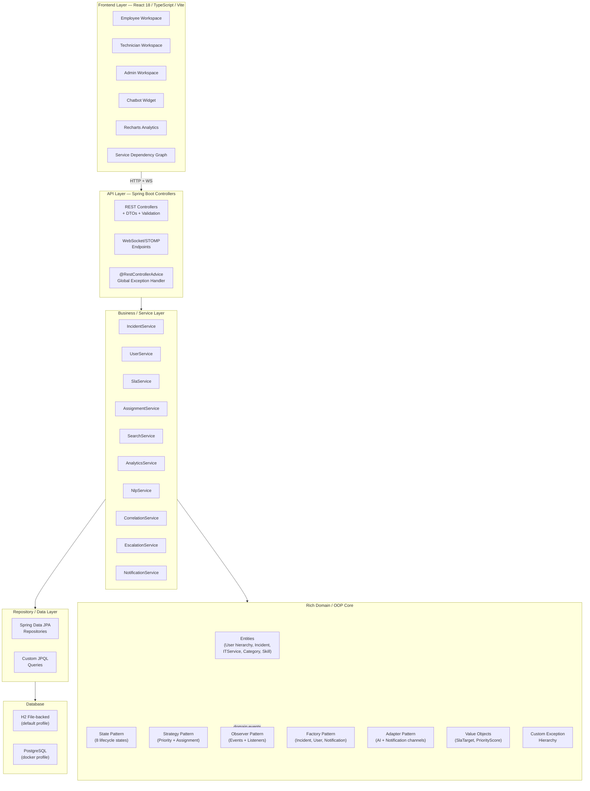
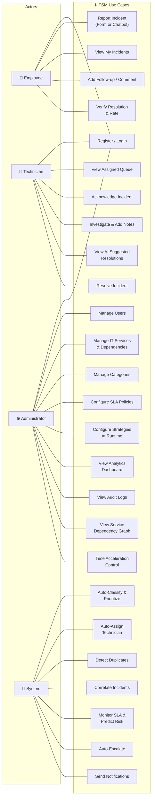
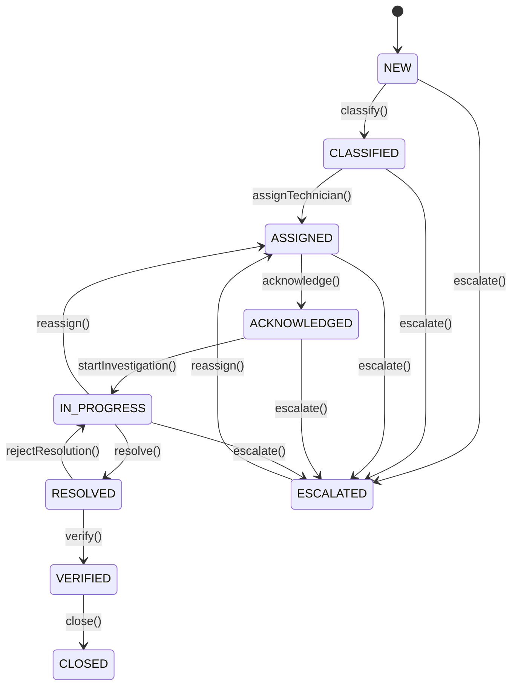
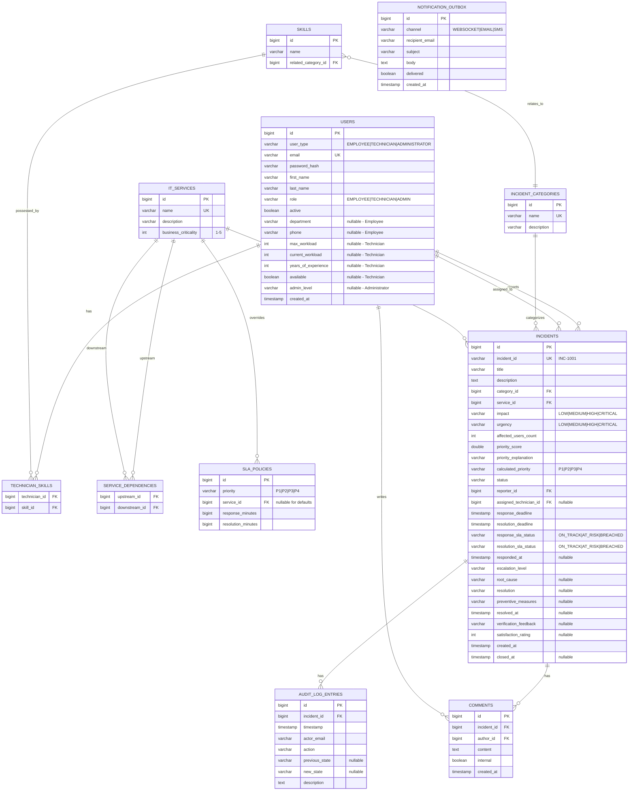

# I-ITSM: Intelligent IT Service Management — Implementation Plan

## Goal Description

Design and build a **production-grade Intelligent IT Service Management & Incident Resolution System** as the capstone project for CS F213 / MAC F212. The system must demonstrate every major OOP pillar (encapsulation, abstraction, inheritance, polymorphism, composition/aggregation/association), six classic design patterns (State, Strategy, Observer, Factory, Repository, Adapter), layered architecture, intelligent automation (duplicate detection, SLA prediction, AI categorization, service dependency graphs, conversational chatbot, auto-escalation), role-differentiated UI for 3 user types, 20+ automated tests, and a complete documentation pack.

**Project root:** `c:\Users\bohin\OneDrive\Desktop\iitsm`

---

## User Review Required

> [!IMPORTANT]
> **Project Location:** The project will be created at `c:\Users\bohin\OneDrive\Desktop\iitsm` (not inside the existing `OOPS` folder which contains course materials). Confirm this is acceptable.

> [!IMPORTANT]
> **Database Strategy:** The plan uses H2 (file-backed, `iitsm-data.mv.db` in the project root) as the default profile for zero-config startup (`./mvnw spring-boot:run`), plus a `docker-compose.yml` for PostgreSQL when desired. This means **no Docker or PostgreSQL required for grading** — the app works out of the box.

> [!IMPORTANT]
> **AI Fallback:** The Gemini API adapter will be used when `GEMINI_API_KEY` env var is set. The local TF-IDF/rule-based adapter is the **default** and always works offline. No external API is ever required.

> [!WARNING]
> **Scope is very large.** This plan covers ~120+ Java source files and ~60+ React components. Execution will proceed in 6 phases. Each phase will be verified before advancing. Estimated implementation time is substantial — confirm you're ready to proceed through all phases.

---

## Open Questions

> [!IMPORTANT]
> 1. **Team member names for the demo script?** The demo video script (Phase 6) calls for 4 team members. Please provide names, or I'll use placeholder names (Member A/B/C/D).

> [!IMPORTANT]
> 2. **Any preferred port numbers?** Default plan: Backend on `:8080`, Frontend dev on `:5173`.

> [!IMPORTANT]
> 3. **Git repository?** Should I initialize a Git repo and make commits per phase?

---

## Proposed Architecture Overview

### Layered Architecture Diagram



### UML Use Case Diagram



---

## Proposed Changes

### Component 1: Project Structure & Build Configuration

The entire project lives under `c:\Users\bohin\OneDrive\Desktop\iitsm`:

```
iitsm/
├── backend/                          # Spring Boot application
│   ├── pom.xml                       # Maven build with Spring Boot 3, Java 21
│   ├── mvnw, mvnw.cmd, .mvn/        # Maven wrapper (zero-install build)
│   ├── docker-compose.yml            # PostgreSQL for optional docker profile
│   ├── src/main/
│   │   ├── java/com/iitsm/
│   │   │   ├── IitsmApplication.java
│   │   │   ├── config/              # Security, WebSocket, CORS, Strategy config
│   │   │   ├── domain/
│   │   │   │   ├── model/           # JPA Entities (User hierarchy, Incident, etc.)
│   │   │   │   ├── enums/           # Impact, Urgency, Priority, Status, Role, etc.
│   │   │   │   ├── valueobject/     # SlaTarget, PriorityScore (immutable)
│   │   │   │   ├── state/           # State Pattern (8 state classes)
│   │   │   │   ├── strategy/        # Strategy Pattern (priority + assignment)
│   │   │   │   ├── observer/        # Observer Pattern (event publisher + listeners)
│   │   │   │   ├── factory/         # Factory Pattern (Incident, User, Notification)
│   │   │   │   └── exception/       # Custom exception hierarchy
│   │   │   ├── repository/          # Spring Data JPA repositories
│   │   │   ├── service/             # Business/service layer
│   │   │   ├── controller/          # REST controllers + WebSocket handlers
│   │   │   ├── dto/                 # Request/Response DTOs
│   │   │   ├── infrastructure/
│   │   │   │   └── adapter/         # Adapter Pattern (AI + Notification)
│   │   │   ├── scheduler/           # SLA monitor, escalation scheduler
│   │   │   └── seed/                # DataSeeder (demo data)
│   │   └── resources/
│   │       ├── application.yml      # Default (H2) config
│   │       ├── application-docker.yml # PostgreSQL config
│   │       └── data/                # Optional SQL seed fallback
│   └── src/test/java/com/iitsm/    # 20+ JUnit 5 tests
│
├── frontend/                        # React + TypeScript + Vite
│   ├── package.json
│   ├── vite.config.ts
│   ├── tsconfig.json
│   ├── tailwind.config.js
│   ├── index.html
│   └── src/
│       ├── main.tsx
│       ├── App.tsx
│       ├── api/                     # Axios client, auth interceptor
│       ├── auth/                    # AuthContext, ProtectedRoute, JWT utils
│       ├── components/
│       │   ├── common/              # Layout, Navbar, Sidebar, LoadingSpinner, etc.
│       │   ├── employee/            # Employee workspace components
│       │   ├── technician/          # Technician workspace components
│       │   ├── admin/               # Admin workspace components
│       │   └── chatbot/             # Chatbot widget
│       ├── pages/                   # Route-level page components
│       ├── hooks/                   # Custom hooks (useAuth, useWebSocket, etc.)
│       ├── types/                   # TypeScript interfaces
│       └── utils/                   # Helpers, formatters
│
├── docs/                            # Phase 6 documentation
│   ├── 01_PROBLEM_ANALYSIS_AND_REQUIREMENTS.md
│   ├── 02_ARCHITECTURE_AND_UML.md
│   ├── 03_TECHNOLOGY_SELECTION_REPORT.md
│   ├── 04_DATABASE_DESIGN.md
│   ├── 05_TEST_CASES.md
│   └── 06_DEMO_VIDEO_SCRIPT.md
│
└── README.md                        # Root readme with startup instructions
```

#### [NEW] `backend/pom.xml`
Spring Boot 3.2.x parent, Java 21, dependencies:
- `spring-boot-starter-web`
- `spring-boot-starter-data-jpa`
- `spring-boot-starter-security`
- `spring-boot-starter-validation`
- `spring-boot-starter-websocket`
- `jjwt-api` / `jjwt-impl` / `jjwt-jackson` (0.12.x) for JWT
- `h2` (runtime, default)
- `postgresql` (runtime, docker profile)
- `lombok` (compile-time)
- `spring-boot-starter-test` + `spring-security-test` (test)

#### [NEW] `frontend/package.json`
Dependencies: `react`, `react-dom`, `react-router-dom`, `axios`, `@stomp/stompjs`, `sockjs-client`, `recharts`, `lucide-react`, `reactflow`, `tailwindcss`, `@tailwindcss/forms`.

---

### Component 2: Domain Model — Entity Class Hierarchy

```mermaid
classDiagram
    class User {
        <<abstract>>
        #Long id
        #String email
        #String passwordHash
        #String firstName
        #String lastName
        #Role role
        #boolean active
        #LocalDateTime createdAt
        +getFullName() String
        +getDashboardPermissions()* Set~Permission~
        +canPerformAction(Action)* boolean
    }

    class Employee {
        -String department
        -String phone
        +getDashboardPermissions() Set~Permission~
        +canPerformAction(Action) boolean
    }

    class Technician {
        -Set~Skill~ skills
        -int maxWorkload
        -int currentWorkload
        -int yearsOfExperience
        -boolean available
        +hasSkillFor(IncidentCategory) boolean
        +incrementWorkload()
        +decrementWorkload()
        +isOverloaded() boolean
        +getDashboardPermissions() Set~Permission~
        +canPerformAction(Action) boolean
    }

    class Administrator {
        -String adminLevel
        +getDashboardPermissions() Set~Permission~
        +canPerformAction(Action) boolean
    }

    User <|-- Employee
    User <|-- Technician
    User <|-- Administrator

    class Incident {
        -Long id
        -String incidentId
        -String title
        -String description
        -IncidentCategory category
        -ITService affectedService
        -Impact impact
        -Urgency urgency
        -int affectedUsersCount
        -PriorityScore priorityScore
        -Priority calculatedPriority
        -IncidentState currentState
        -Employee reporter
        -Technician assignedTechnician
        -SlaTracker slaTracker
        -EscalationLevel escalationLevel
        -List~AuditLogEntry~ auditTrail
        -ResolutionDetails resolutionDetails
        -List~Comment~ comments
        -String verificationFeedback
        -int satisfactionRating
        -LocalDateTime createdAt
        -LocalDateTime closedAt
        +transition(IncidentAction, User)
        +classify(IncidentCategory, ITService)
        +assignTechnician(Technician)
        +addAuditEntry(AuditLogEntry)
        +addComment(Comment)
        +resolve(ResolutionDetails)
        +verify(String feedback, int rating)
    }

    class SlaTracker {
        <<composition>>
        -SlaTarget target
        -LocalDateTime responseDeadline
        -LocalDateTime resolutionDeadline
        -SlaStatus responseStatus
        -SlaStatus resolutionStatus
        -LocalDateTime respondedAt
        -LocalDateTime resolvedAt
        +checkCompliance(LocalDateTime now)
        +markResponded(LocalDateTime)
        +markResolved(LocalDateTime)
        +calculateRiskScore() SlaRiskLevel
    }

    class SlaTarget {
        <<value object>>
        -Duration responseTime
        -Duration resolutionTime
        +SlaTarget(Duration, Duration)
    }

    class PriorityScore {
        <<value object>>
        -double score
        -String explanation
        -Priority priority
        +PriorityScore(double, String, Priority)
    }

    class AuditLogEntry {
        <<composition>>
        -Long id
        -LocalDateTime timestamp
        -String actorEmail
        -String action
        -String previousState
        -String newState
        -String description
    }

    class ResolutionDetails {
        <<composition>>
        -String rootCause
        -String resolution
        -String preventiveMeasures
        -LocalDateTime resolvedAt
    }

    class ITService {
        -Long id
        -String name
        -String description
        -int businessCriticality
        -Set~ITService~ upstreamDependencies
        -Set~ITService~ downstreamDependencies
        +addUpstreamDependency(ITService)
        +addDownstreamDependency(ITService)
        +getBlastRadius() Set~ITService~
    }

    class IncidentCategory {
        -Long id
        -String name
        -String description
    }

    class Skill {
        -Long id
        -String name
        -IncidentCategory relatedCategory
    }

    class Comment {
        -Long id
        -String content
        -User author
        -boolean internal
        -LocalDateTime createdAt
    }

    class SlaPolicy {
        -Long id
        -Priority priority
        -ITService service
        -Duration responseTime
        -Duration resolutionTime
    }

    Incident *-- SlaTracker : composition
    Incident *-- "0..*" AuditLogEntry : composition
    Incident *-- "0..1" ResolutionDetails : composition
    Incident "0..*" -- "1" Employee : reporter
    Incident "0..*" -- "0..1" Technician : assignee
    Incident "0..*" -- "1" ITService : affectedService
    Incident "0..*" -- "1" IncidentCategory : category
    Incident "0..*" -- "0..*" Comment : comments
    Technician o-- "0..*" Skill : aggregation
    ITService o-- "0..*" ITService : dependencies
    SlaPolicy -- Priority
    SlaPolicy -- ITService
```



#### JPA Inheritance Strategy

The `User` class uses `@Inheritance(strategy = InheritanceType.SINGLE_TABLE)` with a `@DiscriminatorColumn(name = "user_type")` for simplicity and query performance. Each subclass uses `@DiscriminatorValue`:

```java
@Entity
@Table(name = "users")
@Inheritance(strategy = InheritanceType.SINGLE_TABLE)
@DiscriminatorColumn(name = "user_type", discriminatorType = DiscriminatorType.STRING)
public abstract class User {
    @Id @GeneratedValue(strategy = GenerationType.IDENTITY)
    private Long id;

    @Column(unique = true, nullable = false)
    private String email;

    @Column(nullable = false)
    private String passwordHash;

    // ... encapsulated fields, NO public setters that bypass invariants

    /**
     * OOP: Abstraction — subclasses define their own dashboard capabilities.
     * Demonstrates polymorphism through abstract method override.
     */
    public abstract Set<Permission> getDashboardPermissions();

    /**
     * OOP: Polymorphism — each role decides what actions it can perform.
     */
    public abstract boolean canPerformAction(Action action);
}
```

---

### Component 3: State Pattern — Incident Lifecycle



**Package:** `com.iitsm.domain.state`

Each state is a concrete class implementing the `IncidentState` interface:

```java
/**
 * State Pattern: Interface defining all possible actions on an incident.
 * Each concrete state class permits only valid transitions, throwing
 * InvalidStateTransitionException for illegal ones.
 *
 * OOP: Polymorphism — the Incident delegates behavior to its current state.
 * OOP: Encapsulation — transition rules are encapsulated within each state.
 */
public interface IncidentState {
    Status getStatus();
    IncidentState classify(Incident incident, IncidentCategory category, ITService service);
    IncidentState assign(Incident incident, Technician technician);
    IncidentState acknowledge(Incident incident, Technician technician);
    IncidentState startInvestigation(Incident incident);
    IncidentState resolve(Incident incident, ResolutionDetails details);
    IncidentState verify(Incident incident, String feedback, int rating);
    IncidentState close(Incident incident);
    IncidentState escalate(Incident incident, EscalationLevel level);
    IncidentState reassign(Incident incident, Technician newTechnician);
}
```

**Concrete state classes (8):**

| Class | Permits | Throws `InvalidStateTransitionException` on |
|-------|---------|---------------------------------------------|
| `NewState` | `classify()`, `escalate()` | All others |
| `ClassifiedState` | `assign()`, `escalate()` | All others |
| `AssignedState` | `acknowledge()`, `escalate()`, `reassign()` | `resolve()`, `close()`, etc. |
| `AcknowledgedState` | `startInvestigation()`, `escalate()`, `reassign()` | `resolve()`, `close()`, etc. |
| `InProgressState` | `resolve()`, `escalate()`, `reassign()` | `close()`, `classify()`, etc. |
| `ResolvedState` | `verify()`, reopen to `IN_PROGRESS` | `close()`, `assign()`, etc. |
| `VerifiedState` | `close()` | All others |
| `ClosedState` | None (terminal) | Everything |
| `EscalatedState` | `assign()`/`reassign()` | Most others |

---

### Component 4: Strategy Pattern — Priority & Assignment

**Package:** `com.iitsm.domain.strategy`

#### Priority Calculation Strategies

```java
/**
 * Strategy Pattern: Different algorithms for computing incident priority.
 * OOP: Abstraction — callers depend on the interface, not concrete implementations.
 */
public interface PriorityCalculationStrategy {
    String getStrategyName();
    PriorityScore calculate(Impact impact, Urgency urgency,
                            int serviceCriticality, int affectedUsersCount);
}
```

| Strategy | Algorithm |
|----------|-----------|
| `WeightedScoringPriorityStrategy` | `score = 0.30×impact + 0.30×urgency + 0.25×criticality + 0.15×userCountFactor` → map to P1-P4 by thresholds |
| `MatrixRuleBasedPriorityStrategy` | ITIL 4×4 impact/urgency matrix → escalate by criticality if ≥4 |

#### Technician Assignment Strategies

```java
/**
 * Strategy Pattern: Different algorithms for assigning technicians to incidents.
 * OOP: Polymorphism — each strategy implementation provides a different assignment logic.
 */
public interface TechnicianAssignmentStrategy {
    String getStrategyName();
    Optional<Technician> assignTechnician(Incident incident, List<Technician> availableTechnicians);
}
```

| Strategy | Algorithm |
|----------|-----------|
| `SkillBasedAssignmentStrategy` | Filter technicians with matching skill for incident category, pick one with lowest workload |
| `LoadBasedAssignmentStrategy` | Pick technician with lowest `currentWorkload / maxWorkload` ratio |
| `RoundRobinAssignmentStrategy` | Cycle through available technicians using an atomic counter |
| `SmartCompositeRecommendationStrategy` | Weighted score: `0.30×skillMatch + 0.25×(1 - workloadRatio) + 0.20×experience + 0.15×priorResolutions + 0.10×availability` |

#### Runtime Strategy Switching

```java
@Service
public class StrategyConfigService {
    private final Map<String, PriorityCalculationStrategy> priorityStrategies;
    private final Map<String, TechnicianAssignmentStrategy> assignmentStrategies;
    private volatile String activePriorityStrategy = "weighted-scoring";
    private volatile String activeAssignmentStrategy = "smart-composite";

    /** Admin switches active strategy at runtime — no restart needed */
    public void setActivePriorityStrategy(String strategyName) { ... }
    public void setActiveAssignmentStrategy(String strategyName) { ... }
    public PriorityCalculationStrategy getActivePriorityStrategy() { ... }
    public TechnicianAssignmentStrategy getActiveAssignmentStrategy() { ... }
}
```

---

### Component 5: Observer Pattern — Domain Events

**Package:** `com.iitsm.domain.observer`

```java
/**
 * Observer Pattern: Decouples incident lifecycle events from their handlers.
 * OOP: Abstraction — observers depend on the IncidentEvent interface,
 *       not on the specific event type.
 */
public interface IncidentEventObserver {
    void onEvent(IncidentEvent event);
}

/** Sealed hierarchy of domain events */
public sealed interface IncidentEvent permits
    IncidentCreated, IncidentClassified, PriorityChanged,
    TechnicianAssigned, StatusChanged, SlaApproaching,
    SlaViolated, IncidentEscalated, IncidentResolved, IncidentClosed {

    Long incidentId();
    String incidentDisplayId();
    LocalDateTime timestamp();
}
```

**Concrete Observers:**

| Observer | Responsibility |
|----------|---------------|
| `AuditTrailObserver` | Persists an immutable `AuditLogEntry` for every event |
| `NotificationObserver` | Routes notifications through `NotificationChannel` adapters to affected users (reporter, technician, admins) via WebSocket push + persisted outbox |

**Publisher:**

```java
@Component
public class IncidentEventPublisher {
    private final List<IncidentEventObserver> observers;

    public void publish(IncidentEvent event) {
        observers.forEach(o -> o.onEvent(event));
    }
}
```

---

### Component 6: Factory Pattern

**Package:** `com.iitsm.domain.factory`

| Factory | Responsibility |
|---------|---------------|
| `IncidentFactory` | Validates input fields, generates `INC-XXXX` ID, sets initial `NewState`, invokes priority strategy, computes SLA deadlines, creates audit entry |
| `UserFactory` | Creates `Employee`, `Technician`, or `Administrator` based on role enum, hashes password, validates email uniqueness |
| `NotificationFactory` | Builds channel-specific payloads (WebSocket JSON, email body, SMS text) from domain events |

```java
/**
 * Factory Pattern: Centralizes complex Incident creation logic.
 * OOP: Encapsulation — business rules (validation, ID generation,
 *       initial state, priority computation, SLA attachment) are
 *       encapsulated here, not scattered across controllers.
 */
@Component
public class IncidentFactory {
    public Incident createIncident(CreateIncidentRequest request,
                                   Employee reporter,
                                   PriorityCalculationStrategy priorityStrategy,
                                   SlaPolicy slaPolicy) {
        // 1. Validate inputs
        // 2. Generate INC-XXXX ID
        // 3. Calculate priority
        // 4. Attach NewState
        // 5. Create SlaTracker with deadlines
        // 6. Create initial audit entry
        return incident;
    }
}
```

---

### Component 7: Adapter Pattern — AI & Notifications

**Package:** `com.iitsm.infrastructure.adapter`

#### AI Assistant Adapters

```java
/**
 * Adapter Pattern: Abstracts AI/NLP capabilities behind a port interface.
 * OOP: Abstraction + Polymorphism — service layer depends on the port,
 *       not on Gemini or local NLP implementation details.
 */
public interface AiAssistantPort {
    CategoryPrediction predictCategory(String incidentDescription);
    List<SuggestedResolution> suggestResolutions(String description,
                                                  String category,
                                                  List<ResolvedIncidentSummary> history);
    ChatbotResponse processNaturalLanguage(String userMessage,
                                            ConversationContext context);
}
```

| Adapter | Implementation |
|---------|---------------|
| `GeminiApiAdapter` | Calls Google Gemini API with structured prompts, parses JSON response |
| `LocalNlpAdapter` | TF-IDF vectorization + cosine similarity over historical incidents, keyword-rule category mapping, template-based chatbot |

**Selection logic** in configuration:

```java
@Configuration
public class AiAdapterConfig {
    @Bean
    @ConditionalOnProperty(name = "gemini.api.key")
    public AiAssistantPort geminiAdapter() { return new GeminiApiAdapter(...); }

    @Bean
    @ConditionalOnMissingBean(AiAssistantPort.class)
    public AiAssistantPort localNlpAdapter() { return new LocalNlpAdapter(...); }
}
```

#### Notification Channel Adapters

```java
/**
 * Adapter Pattern: Uniform interface for notification delivery.
 * Adding Slack/Teams requires only a new adapter implementation.
 */
public interface NotificationChannel {
    String getChannelName();
    void send(NotificationPayload payload);
}
```

| Adapter | Implementation |
|---------|---------------|
| `InAppWebSocketAdapter` | Pushes real-time JSON via STOMP to user-specific topic `/topic/notifications/{userId}` |
| `EmailNotificationAdapter` | Logs formatted email body + persists to `notification_outbox` table (simulated) |
| `SmsNotificationAdapter` | Logs SMS text + persists to `notification_outbox` table (simulated) |

---

### Component 8: Custom Exception Hierarchy

**Package:** `com.iitsm.domain.exception`

```mermaid
classDiagram
    class IitsmException {
        <<abstract>>
        #String errorCode
        #HttpStatus httpStatus
    }
    class InvalidLoginException
    class UnauthorizedOperationException
    class InvalidIncidentException
    class InvalidStateTransitionException {
        -String currentState
        -String attemptedAction
    }
    class TechnicianUnavailableException
    class TechnicianWorkloadExceededException {
        -Long technicianId
        -int currentLoad
        -int maxLoad
    }
    class ServiceNotFoundException
    class MissingSlaConfigurationException
    class DuplicateIncidentException {
        -List~String~ candidateDuplicateIds
        -List~Double~ similarityScores
    }
    class DatabaseOperationException
    class ExternalServiceFailureException

    IitsmException <|-- InvalidLoginException
    IitsmException <|-- UnauthorizedOperationException
    IitsmException <|-- InvalidIncidentException
    IitsmException <|-- InvalidStateTransitionException
    IitsmException <|-- TechnicianUnavailableException
    IitsmException <|-- TechnicianWorkloadExceededException
    IitsmException <|-- ServiceNotFoundException
    IitsmException <|-- MissingSlaConfigurationException
    IitsmException <|-- DuplicateIncidentException
    IitsmException <|-- DatabaseOperationException
    IitsmException <|-- ExternalServiceFailureException
```



**Global handler** `GlobalExceptionHandler` with `@RestControllerAdvice` returns RFC-7807 `ProblemDetail` JSON for all exception types, plus field-level `@Valid` errors with 400 status.

---

### Component 9: Database Schema (ER Diagram)



**Tables: 10** (`USERS`, `SKILLS`, `TECHNICIAN_SKILLS`, `INCIDENT_CATEGORIES`, `IT_SERVICES`, `SERVICE_DEPENDENCIES`, `SLA_POLICIES`, `INCIDENTS`, `AUDIT_LOG_ENTRIES`, `COMMENTS`, `NOTIFICATION_OUTBOX`)

---

### Component 10: REST API Contract

#### Authentication Endpoints

| Method | Path | Role | Description |
|--------|------|------|-------------|
| `POST` | `/api/auth/register` | Public | Register new employee |
| `POST` | `/api/auth/login` | Public | Login, returns JWT |
| `GET` | `/api/auth/me` | Authenticated | Get current user profile |

#### Incident Endpoints

| Method | Path | Role | Description |
|--------|------|------|-------------|
| `POST` | `/api/incidents` | EMPLOYEE | Create incident |
| `GET` | `/api/incidents` | Authenticated | Search/filter incidents (8+ query params) |
| `GET` | `/api/incidents/{id}` | Authenticated | Get incident detail with audit trail |
| `PUT` | `/api/incidents/{id}/classify` | ADMIN, SYSTEM | Classify incident (category + service) |
| `PUT` | `/api/incidents/{id}/assign` | ADMIN, SYSTEM | Assign technician |
| `PUT` | `/api/incidents/{id}/acknowledge` | TECHNICIAN | Acknowledge assigned incident |
| `PUT` | `/api/incidents/{id}/start` | TECHNICIAN | Move to IN_PROGRESS |
| `PUT` | `/api/incidents/{id}/resolve` | TECHNICIAN | Submit resolution details |
| `PUT` | `/api/incidents/{id}/verify` | EMPLOYEE | Verify resolution + rating |
| `PUT` | `/api/incidents/{id}/close` | ADMIN | Close incident |
| `PUT` | `/api/incidents/{id}/escalate` | ADMIN, SYSTEM | Escalate incident |
| `PUT` | `/api/incidents/{id}/reassign` | ADMIN | Reassign to different technician |
| `POST` | `/api/incidents/{id}/comments` | Authenticated | Add comment |
| `GET` | `/api/incidents/{id}/audit` | ADMIN | Get full audit trail |
| `GET` | `/api/incidents/{id}/duplicates` | Authenticated | Get duplicate candidates |
| `GET` | `/api/incidents/{id}/suggestions` | TECHNICIAN | Get AI suggested resolutions |
| `GET` | `/api/incidents/my` | EMPLOYEE | My submitted incidents |
| `GET` | `/api/incidents/assigned` | TECHNICIAN | My assigned incidents |

#### User / Technician Management

| Method | Path | Role | Description |
|--------|------|------|-------------|
| `GET` | `/api/users` | ADMIN | List all users |
| `GET` | `/api/technicians` | ADMIN | List technicians with workload |
| `PUT` | `/api/technicians/{id}` | ADMIN | Update skills, availability, max workload |

#### IT Service & Category Management

| Method | Path | Role | Description |
|--------|------|------|-------------|
| `GET` | `/api/services` | Authenticated | List all IT services |
| `POST` | `/api/services` | ADMIN | Create service |
| `PUT` | `/api/services/{id}` | ADMIN | Update service |
| `GET` | `/api/services/dependencies` | Authenticated | Get dependency graph |
| `GET` | `/api/categories` | Authenticated | List categories |
| `POST` | `/api/categories` | ADMIN | Create category |

#### SLA & Strategy Configuration

| Method | Path | Role | Description |
|--------|------|------|-------------|
| `GET` | `/api/sla-policies` | ADMIN | List SLA policies |
| `PUT` | `/api/sla-policies/{id}` | ADMIN | Update SLA policy |
| `GET` | `/api/config/strategies` | ADMIN | Get available & active strategies |
| `PUT` | `/api/config/strategies/priority` | ADMIN | Switch active priority strategy |
| `PUT` | `/api/config/strategies/assignment` | ADMIN | Switch active assignment strategy |

#### Analytics & Intelligence

| Method | Path | Role | Description |
|--------|------|------|-------------|
| `GET` | `/api/analytics/overview` | ADMIN | KPI summary |
| `GET` | `/api/analytics/workload` | ADMIN | Technician workload data |
| `GET` | `/api/analytics/service-health` | ADMIN | Incidents by service |
| `GET` | `/api/analytics/priority-distribution` | ADMIN | Priority breakdown |
| `GET` | `/api/analytics/sla-compliance` | ADMIN | SLA compliance metrics |
| `GET` | `/api/correlation/clusters` | ADMIN | Active problem clusters |
| `GET` | `/api/sla/risk-assessment` | ADMIN | Predictive SLA risk for all active |

#### AI / Chatbot

| Method | Path | Role | Description |
|--------|------|------|-------------|
| `POST` | `/api/ai/categorize` | Authenticated | Auto-categorize description |
| `POST` | `/api/chatbot/message` | EMPLOYEE | Chatbot conversation turn |
| `POST` | `/api/chatbot/submit` | EMPLOYEE | Submit chatbot-assembled incident |

#### Demo / Time Acceleration

| Method | Path | Role | Description |
|--------|------|------|-------------|
| `POST` | `/api/demo/advance-time` | ADMIN | Advance simulated clock by N minutes |
| `POST` | `/api/demo/trigger-sla-check` | ADMIN | Manually trigger SLA check cycle |

#### WebSocket Topics (STOMP over SockJS)

| Topic | Subscriber | Events |
|-------|-----------|--------|
| `/topic/notifications/{userId}` | Specific user | All notification payloads |
| `/topic/incidents/updates` | All authenticated | Real-time incident status changes |
| `/topic/sla/alerts` | ADMIN, TECHNICIAN | SLA warnings & violations |

---

### Component 11: Frontend Routes & Role-Differentiated UI

#### Route Map

| Route | Component | Roles | Description |
|-------|-----------|-------|-------------|
| `/login` | `LoginPage` | Public | Login + Demo Quick-Login buttons |
| `/register` | `RegisterPage` | Public | Employee registration |
| `/employee` | `EmployeeDashboard` | EMPLOYEE | My incidents overview |
| `/employee/report` | `ReportIncidentPage` | EMPLOYEE | Report via form |
| `/employee/incidents/:id` | `IncidentDetailPage` | EMPLOYEE | Incident detail + verify |
| `/technician` | `TechnicianDashboard` | TECHNICIAN | Assigned queue + workload meter |
| `/technician/incidents/:id` | `TechnicianIncidentPage` | TECHNICIAN | Investigate + resolve |
| `/admin` | `AdminDashboard` | ADMIN | Analytics overview |
| `/admin/incidents` | `AllIncidentsPage` | ADMIN | All incidents with search/filter |
| `/admin/incidents/:id` | `AdminIncidentPage` | ADMIN | Full detail + reassign + escalate |
| `/admin/users` | `UserManagementPage` | ADMIN | Manage users & technicians |
| `/admin/services` | `ServiceManagementPage` | ADMIN | Manage services + dependencies |
| `/admin/categories` | `CategoryManagementPage` | ADMIN | Manage categories |
| `/admin/sla` | `SlaPolicyPage` | ADMIN | Configure SLA policies |
| `/admin/strategies` | `StrategyConfigPage` | ADMIN | Switch active strategies |
| `/admin/audit` | `AuditLogPage` | ADMIN | Browse audit trail |
| `/admin/dependency-graph` | `DependencyGraphPage` | ADMIN | Interactive service graph |

#### Key UI Components

| Component | Library | Purpose |
|-----------|---------|---------|
| `IncidentLifecycleStepper` | Custom + Lucide | Visual step indicator showing incident state progression |
| `WorkloadMeter` | Custom | Circular progress showing technician capacity utilization |
| `SlaCountdown` | Custom | Live countdown timer for SLA deadlines with color coding |
| `ChatbotWidget` | Custom | Floating chatbot for natural language incident reporting |
| `AnalyticsCharts` | Recharts | Bar, pie, and area charts for KPIs |
| `ServiceDependencyGraph` | React Flow | Interactive directed graph of IT services |
| `NotificationBell` | Custom + WS | Real-time notification dropdown via WebSocket |
| `SearchFilterBar` | Custom | Multi-criteria search with 8+ filter fields |
| `AuditTimeline` | Custom | Chronological timeline of incident events |
| `DemoToolbar` | Custom | Admin-only time acceleration controls |

---

### Component 12: Intelligence Engine Implementation Details

#### D1. Duplicate Detection Algorithm

```
Input: New incident (title, description, service, category)
1. Tokenize & normalize (lowercase, remove stop words, stem)
2. Build TF-IDF vector for new incident
3. For each open/recent incident (last 72 hours, same service or category):
   a. Compute cosine similarity of TF-IDF vectors
   b. Boost score by +0.15 if same service, +0.10 if same category
   c. Boost score by +0.10 if within 1-hour time window
4. If composite score >= 0.65 threshold:
   → Flag as potential duplicate with similarity %, offer "Link as Duplicate" action
5. Return top-5 candidates sorted by score
```

#### D2. Incident Correlation & Problem Clustering

```
1. Maintain in-memory service dependency adjacency list (Map<Long, Set<Long>>)
2. When a new incident is created:
   a. Find all open incidents on the same service or on services within
      2-hop graph distance (upstream/downstream)
   b. If ≥2 incidents in related services within a 30-minute window:
      → Create/update Problem Cluster
      → Compute blast radius (all services reachable from affected nodes)
      → Highlight on dependency graph
```

#### D3. SLA Risk Prediction

```java
public SlaRiskLevel calculateRisk(Incident incident, LocalDateTime now) {
    double elapsedPercent = computeElapsedPercent(incident, now);
    double workloadFactor = technicianWorkloadRatio(incident);
    double historyFactor = avgResolutionTimeForCategory(incident);

    double riskScore = 0.50 * elapsedPercent
                     + 0.25 * workloadFactor
                     + 0.25 * historyFactor;

    if (riskScore >= 0.80) return HIGH;
    if (riskScore >= 0.50) return MEDIUM;
    return LOW;
}
```

#### D4. Auto-Escalation Engine

```
Scheduled job runs every 60 seconds (configurable):
For each active incident with priority P1 or P2:
  1. If not acknowledged within response SLA → escalate one level
  2. If resolution SLA at 75% → SLA_APPROACHING warning event
  3. If resolution SLA breached → SLA_VIOLATED event + escalate one level

Escalation chain: TECHNICIAN → TEAM_LEAD → SYSTEM_ADMIN → IT_MANAGER
Each escalation logs an audit entry and fires notification to the next tier.
```

#### D5. AI Auto-Categorization (Local Fallback)

```
LocalNlpAdapter.predictCategory(description):
1. Keyword rule map:
   "password|login|authentication|sso|mfa" → Authentication
   "network|connectivity|wifi|vpn|firewall" → Network
   "database|sql|query|data loss|backup" → Database
   "payment|transaction|checkout|billing" → Application
   "disk|storage|nas|backup" → Storage
   "cloud|aws|azure|gcp|vm" → Cloud
   "email|outlook|teams|communication" → Software
   "hardware|printer|monitor|keyboard" → Hardware
   "security|breach|malware|phishing" → Security
2. If multiple match: pick category with most keyword hits
3. Confidence: hits / total_keywords_in_description (capped at 0.95)
4. If no match: return "Software" with 0.30 confidence
```

#### D6. Chatbot Conversation Flow

```
State machine with 5 steps:
1. GREETING → "What issue are you experiencing?"
2. DESCRIBE → Extract keywords → auto-detect service + category
3. CONFIRM_SERVICE → "Looks like this affects [Payment Gateway]. Is that right?"
4. ASSESS_IMPACT → "How many users are affected?" + "How urgent is this?"
5. REVIEW → Show summary → check for duplicates → "Submit this incident?"
```

---

### Component 13: Security Configuration

```java
@Configuration
@EnableWebSecurity
@EnableMethodSecurity
public class SecurityConfig {
    // JWT filter chain:
    // 1. JwtAuthenticationFilter reads Authorization: Bearer <token>
    // 2. Validates token, extracts email + role
    // 3. Sets SecurityContext
    // 4. @PreAuthorize("hasRole('ADMIN')") guards endpoints

    // Public endpoints: /api/auth/**, /ws/**
    // All others: authenticated

    // CORS: Allow frontend origin (localhost:5173)
    // CSRF: Disabled (stateless JWT)
    // Session: STATELESS
}
```

**JWT Token Structure:**
```json
{
  "sub": "admin@iitsm.org",
  "role": "ADMIN",
  "userId": 1,
  "firstName": "Admin",
  "iat": 1700000000,
  "exp": 1700086400
}
```

---

### Component 14: Seed Data

**`DataSeeder` runs on startup (`@PostConstruct` or `ApplicationRunner`) with idempotency check:**

**Users (7):**
| Email | Role | Skills | Workload | Experience |
|-------|------|--------|----------|------------|
| `employee@iitsm.org` | Employee | — | — | — |
| `employee2@iitsm.org` | Employee | — | — | — |
| `employee3@iitsm.org` | Employee | — | — | — |
| `tech.alex@iitsm.org` | Technician | Network, Security, Cloud | 2/5 | 7 yrs |
| `tech.priya@iitsm.org` | Technician | Database, Application, Storage | 1/5 | 5 yrs |
| `tech.rohan@iitsm.org` | Technician | Hardware, Software, Authentication | 3/5 | 3 yrs |
| `admin@iitsm.org` | Administrator | — | — | — |

**IT Services (7) + Dependencies:**
```
Payment Gateway (5) → Core Database (5), Authentication Service (5)
HR Portal (2) → Core Database (5), Authentication Service (5)
Cloud Storage (3) → Enterprise Network (4)
Email & Comms (3) → Enterprise Network (4), Authentication Service (5)
```

**Categories (9):** Hardware, Software, Network, Database, Cloud, Security, Authentication, Application, Storage

**SLA Policies (4 defaults + 1 override):**
| Priority | Response | Resolution | Service Override |
|----------|----------|------------|-----------------|
| P1 | 5 min | 30 min | — |
| P2 | 15 min | 2 hours | — |
| P3 | 1 hour | 8 hours | — |
| P4 | 4 hours | 24 hours | — |
| P1 | 3 min | 20 min | Payment Gateway |

**Historical + Active Incidents (15+):**
- 5 CLOSED incidents (resolved with detailed root causes & resolutions) spanning Payment, Database, Network categories — these power the "Suggested Resolutions" engine
- 3 RESOLVED incidents awaiting verification
- 3 IN_PROGRESS incidents with varied SLA states (ON_TRACK, AT_RISK)
- 2 ASSIGNED incidents (not yet acknowledged)
- 2 NEW incidents (just reported)
- Each incident has 2–5 audit log entries showing realistic lifecycle progression

---

### Component 15: Data Structures Usage Map

| Data Structure | Location | Purpose |
|---------------|----------|---------|
| `PriorityQueue<Incident>` | `EscalationScheduler` | Triage queue ordered by priority score + SLA urgency for escalation processing |
| `Map<String, Strategy>` | `StrategyConfigService` | Strategy registry for runtime lookup by name |
| `Map<Long, Set<Long>>` | `ServiceDependencyGraph` | Adjacency list for service dependency traversal (BFS blast radius) |
| `Map<String, Double>` | `TfIdfVectorizer` | Term → IDF weight lookup for similarity computation |
| `Set<Skill>` | `Technician` entity | Unique skill profiles for skill-based assignment matching |
| `Set<Long>` | `ProblemCluster` | Correlated incident group IDs (no duplicates) |
| `List<AuditLogEntry>` | `Incident` entity | Ordered (by timestamp) immutable audit trail |
| `List<SuggestedResolution>` | AI response | Top-3 ranked resolution suggestions |
| `AtomicInteger` | `RoundRobinAssignmentStrategy` | Thread-safe counter for round-robin cycling |

---

## Verification Plan

### Phase Verification Checkpoints

| Phase | Checkpoint | Verification Method |
|-------|-----------|-------------------|
| **Phase 2** | Backend compiles | `./mvnw compile` exits 0 |
| **Phase 2** | App starts with H2 | `./mvnw spring-boot:run` → healthy on :8080 |
| **Phase 2** | Seed data loads | Hit `/api/auth/login` with demo credentials |
| **Phase 2** | RBAC works | Unauthorized requests return 401/403 |
| **Phase 3** | Intelligence engines work | Unit tests for duplicate detection, SLA risk, categorization |
| **Phase 4** | Frontend builds | `npm run build` exits 0 |
| **Phase 4** | Frontend renders | Dev server on :5173, all 3 role dashboards load |
| **Phase 5** | 20+ tests pass | `./mvnw test` — all green |
| **Phase 5** | Workflow 1 | Employee reports → auto-classified → assigned → notifications |
| **Phase 5** | Workflow 2 | Technician acknowledges → resolves → Employee verifies → Closed |
| **Phase 5** | Workflow 3 | Duplicates detected → SLA acceleration → escalation |
| **Phase 6** | Docs complete | All 6 docs + README exist in `/docs` |

### Automated Tests (20+ planned)

| # | Test | Category | Class |
|---|------|----------|-------|
| 1 | Full lifecycle: NEW → CLOSED | Integration | `IncidentLifecycleTest` |
| 2 | Invalid transition: NEW → CLOSED | Unit | `StatePatternTest` |
| 3 | Invalid transition: ASSIGNED → RESOLVED | Unit | `StatePatternTest` |
| 4 | Invalid transition: CLOSED → anything | Unit | `StatePatternTest` |
| 5 | WeightedScoring: P1 boundary (high impact, high urgency, crit service) | Unit | `PriorityStrategyTest` |
| 6 | WeightedScoring: P4 boundary (low everything) | Unit | `PriorityStrategyTest` |
| 7 | MatrixRuleBased: criticality escalation | Unit | `PriorityStrategyTest` |
| 8 | SkillBasedAssignment: matches correct technician | Unit | `AssignmentStrategyTest` |
| 9 | LoadBasedAssignment: picks least loaded | Unit | `AssignmentStrategyTest` |
| 10 | RoundRobinAssignment: cycles correctly | Unit | `AssignmentStrategyTest` |
| 11 | SmartComposite: weighted ranking | Unit | `AssignmentStrategyTest` |
| 12 | Runtime strategy switch (priority) | Integration | `StrategyConfigTest` |
| 13 | Runtime strategy switch (assignment) | Integration | `StrategyConfigTest` |
| 14 | Technician workload exceeded exception | Unit | `TechnicianTest` |
| 15 | Technician unavailable exception | Unit | `TechnicianTest` |
| 16 | SLA calculation & deadline correctness | Unit | `SlaTrackerTest` |
| 17 | SLA breach detection | Unit | `SlaTrackerTest` |
| 18 | SLA risk prediction scoring | Unit | `SlaRiskTest` |
| 19 | Duplicate detection: similar payment incidents | Unit | `DuplicateDetectionTest` |
| 20 | Duplicate detection: dissimilar incidents (no false positive) | Unit | `DuplicateDetectionTest` |
| 21 | Incident correlation: related services clustered | Unit | `CorrelationTest` |
| 22 | Auto-categorization: payment keywords → Application | Unit | `CategorizationTest` |
| 23 | Audit trail immutability: entries created on transitions | Integration | `AuditTrailTest` |
| 24 | Auth: login with valid credentials → JWT returned | Integration | `AuthControllerTest` |
| 25 | Auth: login with invalid credentials → 401 | Integration | `AuthControllerTest` |
| 26 | RBAC: Employee cannot access admin endpoints → 403 | Integration | `RbacTest` |
| 27 | RBAC: Technician cannot create incidents → 403 | Integration | `RbacTest` |
| 28 | Validation: incident with blank title → 400 | Integration | `ValidationTest` |
| 29 | Factory: IncidentFactory creates with correct initial state | Unit | `IncidentFactoryTest` |
| 30 | Observer: events trigger audit + notification | Integration | `ObserverTest` |

### Manual Verification

After automated tests pass, I will:
1. Boot the full app (backend + frontend)
2. Navigate to the login page and use Demo Quick-Login
3. Walk through all 3 workflows end-to-end
4. Verify WebSocket notifications appear in real-time
5. Verify the Admin dependency graph renders
6. Verify time acceleration triggers SLA warnings

---

## Execution Phases (Summary)

### Phase 1 ✅ — This Document
Architecture plan artifact for your review.

### Phase 2 — Backend Domain Model & Infrastructure
~70 Java files: entities, enums, value objects, all 6 patterns, exception hierarchy, repositories, services, controllers, DTOs, security, WebSocket, seed data, configurations. **Build & boot verified.**

### Phase 3 — Intelligence Engines
~15 Java files: TF-IDF vectorizer, duplicate detector, correlation engine, SLA risk predictor, escalation scheduler, local NLP adapter, Gemini adapter (optional), chatbot service. **Unit tests for each engine.**

### Phase 4 — Frontend UI
~60 TypeScript/React files: auth flow, 3 role workspaces, all pages/components, WebSocket integration, Recharts analytics, React Flow dependency graph, chatbot widget. **Build verified.**

### Phase 5 — Testing & Verification
30 test methods across ~10 test classes. Full `./mvnw test` green. Live browser verification of all 3 workflows.

### Phase 6 — Documentation
7 Markdown files in `/docs` with Mermaid diagrams, structured tables, and the demo video script.

---

## OOP & Design Pattern Defense Map

This table maps every OOP concept and pattern to its exact location in the codebase for auditing:

| Concept | Evidence | File(s) |
|---------|----------|---------|
| **Encapsulation** | Private fields, invariant-enforcing methods, no anemic setters | `Incident.java`, `Technician.java`, `SlaTracker.java` |
| **Abstraction** | Abstract base class + abstract methods | `User.java` (abstract `getDashboardPermissions()`, `canPerformAction()`) |
| **Inheritance** | `Employee`, `Technician`, `Administrator` extend `User` | `model/User.java`, `model/Employee.java`, etc. |
| **Polymorphism** | State dispatch, strategy selection, observer iteration | `IncidentState` implementations, `*Strategy` implementations |
| **Composition** | Incident owns SlaTracker, AuditLogEntry, ResolutionDetails | `Incident.java` (`@Embedded`, `@OneToMany(cascade=ALL, orphanRemoval=true)`) |
| **Aggregation** | Technician has Skills (independent lifecycle) | `Technician.java` (`@ManyToMany`) |
| **Association** | Incident ↔ Employee, Technician, ITService, Category | `Incident.java` (`@ManyToOne`) |
| **Generics** | `PriorityQueue<Incident>`, `Map<String, Strategy>`, typed repositories | Throughout service and domain layers |
| **Custom Exceptions** | `IitsmException` hierarchy (12 exception classes) | `domain/exception/*.java` |
| **Collections** | `PriorityQueue`, `HashMap`, `HashSet`, `ArrayList` | Per data structures table above |
| **State Pattern** | 8 state classes + `IncidentState` interface | `domain/state/*.java` |
| **Strategy Pattern** | 2+4 strategy classes + 2 interfaces | `domain/strategy/*.java` |
| **Observer Pattern** | Publisher + 2 observers + sealed event hierarchy | `domain/observer/*.java` |
| **Factory Pattern** | 3 factory classes | `domain/factory/*.java` |
| **Repository Pattern** | 7+ Spring Data JPA repository interfaces | `repository/*.java` |
| **Adapter Pattern** | 2 AI + 3 notification adapters + 2 port interfaces | `infrastructure/adapter/*.java` |
