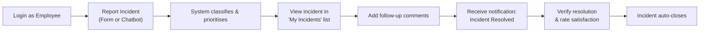
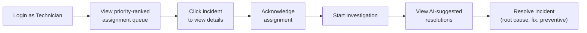
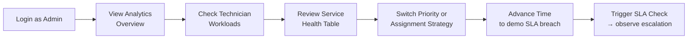

# 01 — Problem Analysis & Requirements Specification

## 1. Problem Statement

Modern enterprises face a persistent challenge managing IT service disruptions. Existing service desks rely on manual triaging, ad-hoc escalation, and spreadsheet-based SLA tracking, leading to:

| Pain Point | Business Impact |
|------------|----------------|
| **Manual Classification** | Mis-categorised incidents delay resolution by 30-50% |
| **Static Prioritisation** | No consideration of service criticality, blast radius, or affected-user count |
| **Opaque SLA Tracking** | SLA breaches detected only after the fact; no proactive risk warnings |
| **Knowledge Silos** | Past resolutions are locked in individual technicians' heads |
| **No Automated Escalation** | Stalled incidents languish without upper-tier attention |
| **Limited Visibility** | Administrators lack real-time analytics for capacity planning |

**I-ITSM** solves these problems by encapsulating ITIL-aligned incident lifecycle management inside a **rich OOP domain model** (State, Strategy, Observer, Factory, Adapter patterns) while layering intelligent automation on top (AI-driven categorisation, duplicate detection, suggested resolutions, SLA prediction, auto-escalation).

---

## 2. Functional Requirements

### FR-01  User Authentication & Authorisation
- Employee self-registration with organizational details (First/Last Name, Email, Department, Phone, Password).
- Role-based login supporting three distinct actors: Employee, Technician, and Administrator.
- JWT-based stateless authentication with role-guarded endpoints (`@PreAuthorize`).
- Account Lockout Mechanism: Automatically locks account for 15 minutes after 5 consecutive failed login attempts; counter resets upon successful authentication.
- Password Recovery: 2-step verification token flow with simulated email outbox delivery, single-use token invalidation, and 15-minute token expiration.

### FR-02  Incident Reporting & Multimodal Input
- Employees can report incidents through a web form, conversational AI chatbot, or browser-based voice dictation.
- Voice-based incident dictation: Web Speech API transcribes spoken input directly into the description field with live editing.
- Multimedia evidence attachments: Supports attaching screenshots, diagnostic images, and log files.
- System auto-generates sequential, collision-free `INC-XXXX` identifiers.

### FR-03  Automated Classification & Prioritisation
- System automatically predicts an incident's category from its description using an AI adapter (keyword NLP or Gemini API).
- Priority is calculated by a pluggable **Strategy** (`MatrixRuleBasedPriorityStrategy` or `WeightedScoringPriorityStrategy`), combining impact, urgency, service criticality, and affected-user count.
- Priority strategy can be switched at runtime by an administrator without application restart.

### FR-04  Duplicate Detection
- On creation, the system computes similarity (Jaccard / TF-IDF) against open incidents and warns of potential duplicates with similarity scores.

### FR-05  Technician Assignment
- Pluggable assignment strategies: `SkillBasedAssignmentStrategy`, `LoadBasedAssignmentStrategy`, `RoundRobinAssignmentStrategy`, or `SmartCompositeRecommendationStrategy`.
- Assignment strategy is switchable at runtime by an administrator.
- System enforces workload caps (`maxWorkload`) and skill-match validation.

### FR-06  Incident Lifecycle Management (10-State Pattern)
- Exactly ten domain states: `NEW` → `CLASSIFIED` → `ASSIGNED` → `ACKNOWLEDGED` → `IN_PROGRESS` → `PENDING_USER` → `RESOLVED` → `VERIFIED` → `CLOSED`, plus `ESCALATED`.
- **SLA Clock Pausing in PENDING_USER:** When a technician requests clarification (`requestInfo()`), the ticket transitions to `PENDING_USER` and the SLA clock is formally paused (`SlaStatus.PAUSED`).
- When the user responds (`resumeWork()`), the ticket returns to `IN_PROGRESS`, the paused duration is recorded (`totalSlaPausedMinutes`), and the SLA deadline is extended by that exact duration.
- Incident reopening: An employee can reject an unsatisfactory resolution (`reopen()`), which returns the ticket to `IN_PROGRESS` and increments `reopenCount`.
- State transitions are strictly enforced by the State pattern — illegal transitions throw `InvalidStateTransitionException`.
- Each transition generates an immutable audit log entry and publishes a domain event.

### FR-07  SLA Monitoring & Prediction
- SLA policies define response and resolution deadlines per priority (with optional per-service overrides).
- A scheduled job checks active incidents, computing elapsed time against deadlines.
- When ≥80% of response/resolution time is consumed, an `SlaApproaching` warning fires.
- When the deadline is exceeded, an `SlaViolated` breach event fires.
- SLA risk assessment available per-incident (LOW / MEDIUM / HIGH / CRITICAL).

### FR-08  Hierarchical Escalation (Chain of Responsibility)
- Escalation uses the classic Gang of Four **Chain of Responsibility** pattern (`EscalationChain` delegating across `TechnicianEscalationHandler` → `TeamLeadEscalationHandler` → `AdminEscalationHandler` → `ItManagerEscalationHandler`).
- Each tier handles its respective threshold or passes to the next successor with full audit attribution.

### FR-09  AI-Suggested Resolutions
- For any active incident, the system retrieves closed incidents in the same category and ranks them by text similarity.
- Technicians see a list of suggested resolutions with match percentages.

### FR-10  Comments & Collaboration
- Any authenticated user can add comments to an incident (public or internal).
- Comments are timestamped and attributed.

### FR-11  Real-Time Notifications (Observer Pattern)
- Domain events trigger notifications via three channels: In-App WebSocket (STOMP push), Email (simulated outbox), SMS (simulated).
- All notifications are persisted in an outbox repository.

### FR-12  Administrative Management & Control Panel
- Administrators have complete control:
  - **SLA Policy Editor:** Dynamically update response and resolution target minutes per priority and service.
  - **IT Service Catalog:** Register new IT services with business criticality (1-5) and upstream dependency mapping.
  - **Category Configuration:** Add new incident categories for routing.
  - **Technician Fleet Management:** Adjust individual technician maximum capacity and toggle availability (Available / Away).
  - **All-Incidents Dispatch & Reassignment:** Live monitor of all system tickets with administrative override to manually reassign tickets to any technician.
  - **Immutable System Audit Trail:** Comprehensive viewer of all audit log entries with real-time text filtering.

### FR-13  Time Acceleration (Demo & Evaluation Mode)
- Administrator can advance simulated time by N minutes to trigger SLA warnings, breaches, and automatic escalation during demos.
- Clearly labeled as an administrative evaluation tool.

### FR-14  Service Dependency Graph & Root Cause Ranking
- Directed acyclic graph (DAG) modeling IT service dependencies.
- Breadth-First Search (BFS) computes the transitive blast radius of downstream affected services.
- **Automated Root Cause Ranking Score:** Ranks upstream services using an objective formula:
  $$\text{Root Cause Score} = (\text{Criticality} \times 25) + (\text{Blast Radius} \times 15) + (\text{Downstream Active Incidents} \times 20)$$
  Normalized to 100, replacing arbitrary confidence claims with clear structural metrics.

### FR-15  Runtime Strategy Configuration
- Switch priority calculation and technician assignment strategies dynamically via REST endpoints without redeployment.

---

## 3. Non-Functional Requirements

| ID | Requirement | Target |
|----|-------------|--------|
| NFR-01 | **Zero-config startup** | `./mvnw spring-boot:run` with H2 — no external DB needed |
| NFR-02 | **Idempotent seed data** | 7 users, 7 services, 9 categories, 5 SLA policies, 15+ incidents on first run |
| NFR-03 | **Security** | Stateless JWT, bcrypt password hashing, CORS whitelist, role-based access control |
| NFR-04 | **API consistency** | RFC-7807 error responses via `@RestControllerAdvice` |
| NFR-05 | **Offline AI** | Local NLP adapter works without any API key; Gemini activates only when `gemini.api.key` is set |
| NFR-06 | **Code quality** | No anemic domain model — entities encapsulate business rules; no raw setter exposure |
| NFR-07 | **Testability** | 42 automated tests (JUnit 5 on Java 21) covering domain lifecycle, security lockout, boundary checks, SLA pausing, and Chain of Responsibility |

---

## 4. User Workflows

### 4.1 Employee Workflow: Report → Track → Verify

**Detailed Steps:**
1. Employee logs in with `employee@iitsm.org` / `Password@123`.
2. Clicks "Report Incident" — fills in title, description, selects impact/urgency/service, optionally specifies affected user count.
3. System invokes `IncidentFactory` which: validates inputs, generates `INC-XXXX` ID, calls `PriorityCalculationStrategy.calculate()`, attaches `SlaTarget` deadlines, sets `NewState`, publishes `IncidentCreatedEvent`.
4. `LocalNlpAdapter.predictCategory()` auto-classifies; incident transitions to `CLASSIFIED`.
5. Employee sees the incident in their dashboard with priority badge and SLA timers.
6. Employee can add comments at any time.
7. When a technician resolves the incident, the employee receives a WebSocket notification.
8. Employee verifies the resolution, provides feedback and a 1-5 star rating.
9. Incident transitions RESOLVED → VERIFIED → CLOSED.

---

### 4.2 Technician Workflow: Acknowledge → Investigate → Resolve

**Detailed Steps:**
1. Technician logs in with `tech.alex@iitsm.org` / `Password@123`.
2. Dashboard shows incidents assigned to them, sorted by priority (P1 first).
3. SLA breach indicators (🔺) highlight at-risk incidents.
4. Technician clicks an incident → acknowledges it (ASSIGNED → ACKNOWLEDGED).
5. Starts investigation (ACKNOWLEDGED → IN_PROGRESS).
6. Views AI-suggested resolutions from similar closed incidents.
7. Fills in root cause analysis, resolution steps, and preventive measures.
8. Submits resolution (IN_PROGRESS → RESOLVED).
9. Observer pattern fires `IncidentResolvedEvent` → notifications sent to reporter.

---

### 4.3 Administrator Workflow: Monitor → Analyse → Configure

**Detailed Steps:**
1. Admin logs in with `admin@iitsm.org` / `Password@123`.
2. Overview tab shows KPI cards (total, active, resolved, SLA breached), priority pie chart, category bar chart.
3. Workloads tab shows each technician's utilisation gauge (current/max with colour coding).
4. Services tab shows health status per IT service (active incidents, SLA breaches, blast radius).
5. Strategies tab lists available priority and assignment strategies — clicking switches immediately.
6. Time Acceleration toolbar: click "+30 min" → instantly advances simulated clock.
7. Click "Trigger SLA Check" → SLA monitor re-evaluates all active incidents → approaching/breached events fire.

---

## 5. Use Case Summary

| UC ID | Use Case | Primary Actor | Trigger |
|-------|----------|---------------|---------|
| UC-01 | Register / Login | All | User navigates to login page |
| UC-02 | Report Incident (Form) | Employee | Click "Report Incident" button |
| UC-03 | Report Incident (Chatbot) | Employee | Type in chatbot widget |
| UC-04 | View My Incidents | Employee | Dashboard loads |
| UC-05 | Add Comment | All (authenticated) | Click "Post" in incident detail |
| UC-06 | Verify Resolution | Employee | Notification received; resolution reviewed |
| UC-07 | View Assignment Queue | Technician | Dashboard loads |
| UC-08 | Acknowledge Incident | Technician | Click "Acknowledge" button |
| UC-09 | Start Investigation | Technician | Click "Start Investigation" button |
| UC-10 | View AI Suggestions | Technician | Incident detail page loads |
| UC-11 | Resolve Incident | Technician | Fill form, click "Resolve" |
| UC-12 | Manage Users | Admin | Admin panel |
| UC-13 | Manage IT Services | Admin | Admin panel |
| UC-14 | Manage Categories | Admin | Admin panel |
| UC-15 | Configure SLA Policies | Admin | Admin panel |
| UC-16 | Switch Strategies | Admin | Strategies tab |
| UC-17 | View Analytics | Admin | Overview tab |
| UC-18 | View Audit Logs | Admin | API call |
| UC-19 | Time Acceleration | Admin | Click "+N min" button |
| UC-20 | Auto-Classify & Prioritise | System | Incident created |
| UC-21 | Auto-Assign Technician | System/Admin | Incident classified |
| UC-22 | Detect Duplicates | System | Incident created |
| UC-23 | Monitor SLA | System | Scheduler (every 60s) |
| UC-24 | Auto-Escalate | System | Scheduler (every 120s) |
| UC-25 | Send Notifications | System | Domain event published |
