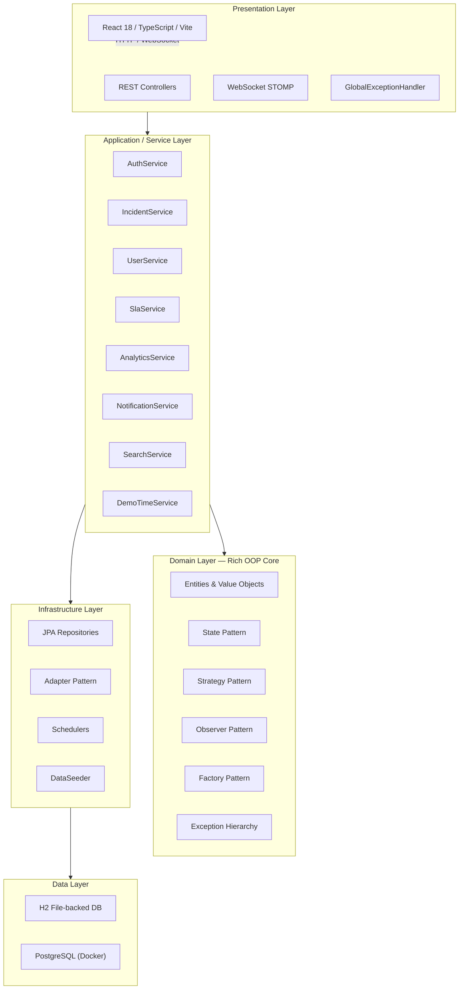
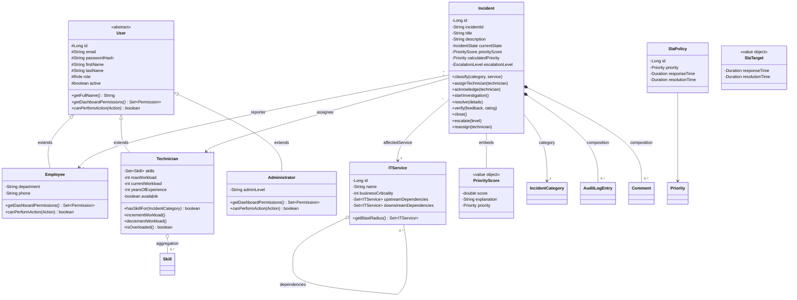
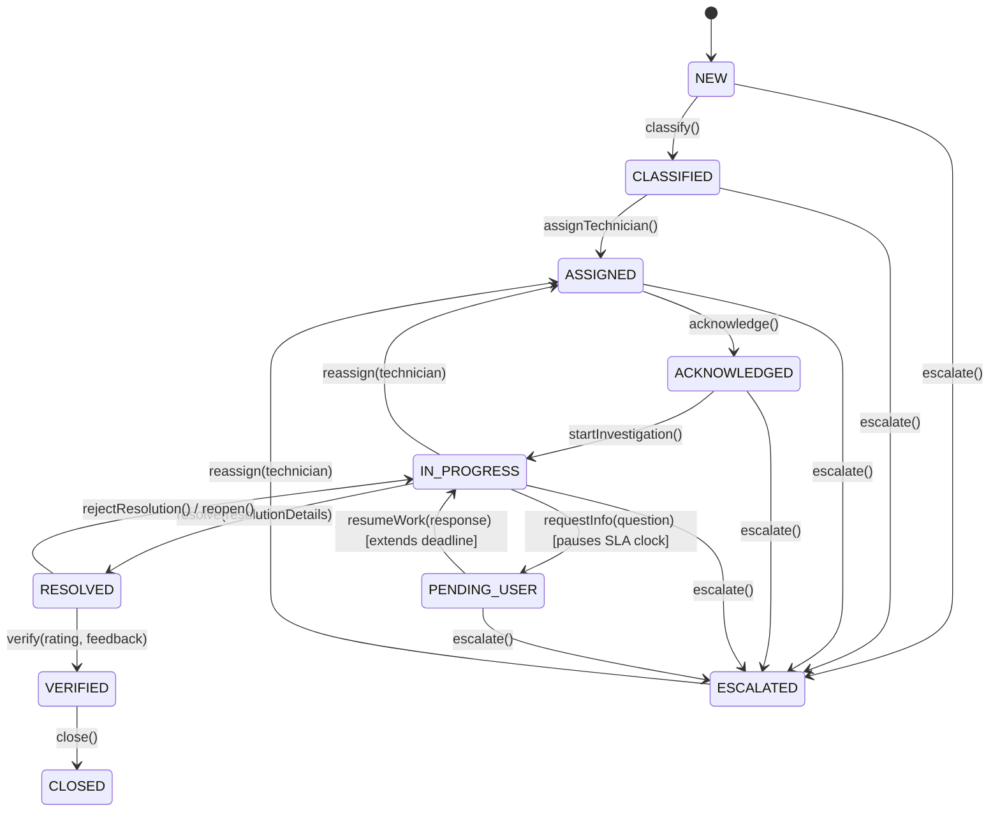
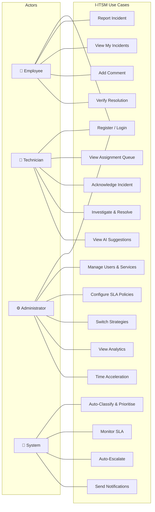
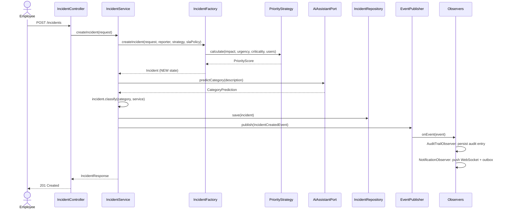

# 02 — Architecture & UML Diagrams

## 1. Layered Architecture

I-ITSM follows a strict **4-layer architecture** with unidirectional dependency flow:



**Key Design Decisions:**
- The **Domain Layer** has zero dependencies on Spring, JPA annotations excepted. Business logic lives in entities, not services.
- The **Service Layer** orchestrates but does not own business rules — it delegates to domain objects.
- The **Infrastructure Layer** implements interfaces defined in the Domain via the Adapter pattern.

---

## 2. Package Structure

```
com.iitsm/
├── IitsmApplication.java                # Spring Boot entry point
├── config/                              # Security, WebSocket, Strategy registry
│   ├── JwtTokenProvider.java
│   ├── JwtAuthenticationFilter.java
│   ├── SecurityConfig.java
│   ├── WebSocketConfig.java
│   └── StrategyConfigService.java
├── controller/                          # REST controllers
│   ├── AuthController.java
│   ├── IncidentController.java
│   ├── UserController.java
│   ├── TechnicianController.java
│   ├── ServiceController.java
│   ├── CategoryController.java
│   ├── SlaPolicyController.java
│   ├── StrategyController.java
│   ├── AnalyticsController.java
│   ├── DemoController.java
│   ├── NotificationController.java
│   ├── AuditController.java
│   └── GlobalExceptionHandler.java
├── domain/
│   ├── enums/        (11 enums)
│   ├── valueobject/  (PriorityScore, SlaTarget)
│   ├── exception/    (IitsmException + 14 subclasses)
│   ├── model/        (12 entities)
│   ├── state/        (IncidentState + 8 states + factory)
│   ├── strategy/     (2 interfaces + 6 implementations)
│   ├── observer/     (10 events + publisher + 2 observers)
│   └── factory/      (IncidentFactory, UserFactory, NotificationFactory, NotificationPayload)
├── dto/
│   ├── request/      (16 request DTOs)
│   └── response/     (23 response DTOs)
├── infrastructure/
│   └── adapter/      (AI port + 2 adapters, Notification channel + 3 adapters)
├── repository/       (12 JPA repositories)
├── scheduler/        (SlaMonitorScheduler, EscalationScheduler)
├── seed/             (DataSeeder)
└── service/          (8 services)
```

---

## 3. Entity Class Diagram



---

## 4. State Machine Diagram — Incident Lifecycle (10 Domain States)



---

## 5. Use Case Diagram



---

## 6. Sequence Diagram — Incident Creation Flow



---

## 7. OOP Concepts — Defense Map

This table maps every core OOP concept to its **concrete implementation** in I-ITSM:

| OOP Concept | Where Implemented | Explanation |
|-------------|-------------------|-------------|
| **Encapsulation** | `Incident.java` domain methods | No public setters. All state mutations go through `classify()`, `assignTechnician()`, `resolve()`, etc., which enforce preconditions and invariants. `Technician.incrementWorkload()` enforces the max-workload cap internally. |
| **Abstraction** | `PriorityCalculationStrategy`, `TechnicianAssignmentStrategy`, `AiAssistantPort`, `NotificationChannelAdapter`, `IncidentState` | Service layer depends on interfaces, never on concrete classes. Callers don't know if priority is computed via weighted scoring or matrix rules. |
| **Inheritance** | `User` → `Employee`, `Technician`, `Administrator` | Single-table JPA inheritance. Each subclass overrides `getDashboardPermissions()` and `canPerformAction()` to define role-specific behaviour. `IitsmException` → 14 specific exception subclasses with distinct HTTP status codes. |
| **Polymorphism** | Strategy pattern, State pattern, Observer pattern | `IncidentService` calls `strategy.calculate()` — the concrete algorithm is selected at runtime. `incident.classify()` delegates to `currentState.classify()` — each state class defines which transitions are valid. `publisher.publish(event)` iterates over all `IncidentEventObserver` implementations. |
| **Composition** | `Incident` ↔ `AuditLogEntry`, `Comment`, `PriorityScore`, `SlaTarget` | Incident *owns* its audit trail and comments (cascade ALL, orphan removal). `PriorityScore` and `SlaTarget` are `@Embeddable` value objects — no identity outside their parent. |
| **Aggregation** | `Technician` ↔ `Skill` | Technician has a set of skills, but skills can exist independently. Skills are shared across technicians. |
| **Association** | `Incident` → `Employee` (reporter), `Incident` → `Technician` (assignee), `Incident` → `ITService` | Simple references — the associated entity has its own lifecycle. |

---

## 8. Design Patterns — Defense Map

| Pattern | Interface / Base | Concrete Implementations | Purpose |
|---------|-----------------|-------------------------|---------|
| **State** (10 Domain States) | `IncidentState` | `NewState`, `ClassifiedState`, `AssignedState`, `AcknowledgedState`, `InProgressState`, `PendingUserState`, `ResolvedState`, `VerifiedState`, `ClosedState`, `EscalatedState` | Encapsulate lifecycle transition rules per state; eliminate giant if-else chains. Pauses SLA clock during `PendingUserState`. |
| **Strategy** | `PriorityCalculationStrategy`, `TechnicianAssignmentStrategy` | `WeightedScoringPriorityStrategy`, `MatrixRuleBasedPriorityStrategy`, `SkillBasedAssignmentStrategy`, `LoadBasedAssignmentStrategy`, `RoundRobinAssignmentStrategy`, `SmartCompositeRecommendationStrategy` | Interchangeable algorithms switchable at runtime by admin. |
| **Chain of Responsibility** | `EscalationHandler`, `BaseEscalationHandler` | `TechnicianEscalationHandler`, `TeamLeadEscalationHandler`, `AdminEscalationHandler`, `ItManagerEscalationHandler`, orchestrated by `EscalationChain` | Hierarchical 4-tier incident escalation without procedural if-else loops; each handler manages its threshold or delegates to successor. |
| **Observer** | `IncidentEventObserver`, `IncidentEvent` | `AuditTrailObserver`, `NotificationObserver`; 10 sealed event records | Decouple event producers from consumers; audit trail and notifications are added without modifying `IncidentService`. |
| **Factory** | — | `IncidentFactory`, `UserFactory`, `NotificationFactory`, `IncidentStateFactory` | Centralise complex creation logic (ID generation, priority computation, SLA deadline calculation, password hashing, state hydration). |
| **Adapter** | `AiAssistantPort`, `NotificationChannelAdapter` | `LocalNlpAdapter`, `GeminiApiAdapter`; `InAppWebSocketAdapter`, `EmailNotificationAdapter`, `SmsNotificationAdapter` | Isolate external service integration behind stable interfaces; swap implementations via Spring's `@ConditionalOnProperty`. |
| **Repository** | Spring Data JPA | 12 repository interfaces with custom JPQL queries | Abstract data access; domain model is persistence-agnostic with immutable audit log enforcement. |
