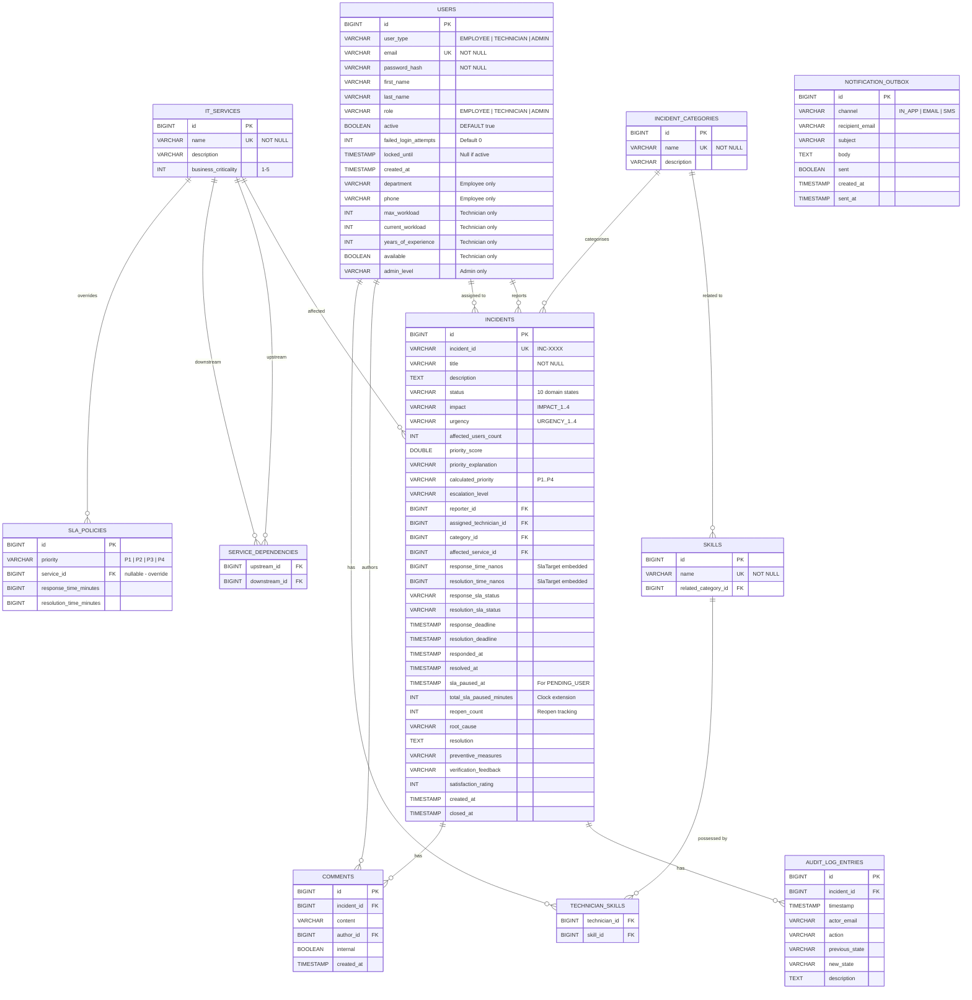

# 04 — Database Design

## 1. ER Diagram

---

## 2. Table Descriptions

### 2.1 `USERS` (Single-Table Inheritance)

The `User` entity hierarchy (`Employee`, `Technician`, `Administrator`) is stored in a single table using JPA's `@Inheritance(strategy = SINGLE_TABLE)` with a `user_type` discriminator column. Nullable columns hold subclass-specific fields.

| Column | Type | Constraint | Description |
|--------|------|-----------|-------------|
| `id` | BIGINT | PK, AUTO | Surrogate key |
| `user_type` | VARCHAR | NOT NULL | Discriminator: `EMPLOYEE`, `TECHNICIAN`, `ADMIN` |
| `email` | VARCHAR | UNIQUE, NOT NULL | Login identifier |
| `password_hash` | VARCHAR | NOT NULL | BCrypt hash |
| `first_name`, `last_name` | VARCHAR | NOT NULL | Display name |
| `role` | VARCHAR | NOT NULL | Enum: `EMPLOYEE`, `TECHNICIAN`, `ADMIN` |
| `active` | BOOLEAN | DEFAULT TRUE | Soft delete flag |
| `department`, `phone` | VARCHAR | Nullable | Employee-specific |
| `max_workload`, `current_workload` | INT | Nullable | Technician-specific |
| `years_of_experience` | INT | Nullable | Technician-specific |
| `available` | BOOLEAN | Nullable | Technician-specific |
| `admin_level` | VARCHAR | Nullable | Administrator-specific |

### 2.2 `INCIDENTS`

Central table storing all incident data including embedded value objects (`PriorityScore`, `SlaTarget`) and resolution details.

**Key indexes:**
- `idx_incident_status` on `status` — for active-incident queries
- `idx_incident_priority` on `calculated_priority` — for queue ordering
- `idx_incident_reporter` on `reporter_id` — for "My Incidents" queries
- `idx_incident_technician` on `assigned_technician_id` — for assignment queue
- `idx_incident_sla` on `response_sla_status, resolution_sla_status` — for SLA breach queries

### 2.3 `AUDIT_LOG_ENTRIES`

Immutable append-only log of every incident state transition. Each entry records the actor, action, previous state, new state, and a human-readable description.

### 2.4 `NOTIFICATION_OUTBOX`

Transactional outbox pattern — notifications are written to this table atomically with the domain event, then dispatched asynchronously. The `sent` flag and `sent_at` timestamp track delivery.

### 2.5 `SERVICE_DEPENDENCIES`

Join table for the many-to-many self-referential relationship on `IT_SERVICES`. Used by `ITService.getBlastRadius()` BFS traversal.

---

## 3. Seed Data Summary

The `DataSeeder` component (`@Component` with `CommandLineRunner`) populates the database idempotently on startup:

| Entity | Count | Key Details |
|--------|-------|-------------|
| **Users** | 7 | 1 Employee (`employee@iitsm.org`), 2 extra employees, 3 Technicians (`tech.alex`, `tech.priya`, `tech.rohan` — different skills & workloads), 1 Admin (`admin@iitsm.org`) |
| **IT Services** | 7 | Payment Gateway, Core Database, Auth Service, Email Platform, CI/CD Pipeline, Monitoring Dashboard, API Gateway — with dependency links |
| **Categories** | 9 | Network, Hardware, Software, Security, Database, Cloud, Email, Access Management, Performance |
| **Skills** | 9 | One per category, linked via `related_category` FK |
| **SLA Policies** | 5 | P1 (15min/1hr), P2 (30min/4hr), P3 (1hr/8hr), P4 (4hr/24hr), Payment Gateway P1 override (10min/30min) |
| **Incidents** | 15+ | Spread across all 9 lifecycle states; 5 closed incidents with resolution details for AI suggestion matching |

All users have password: `Password@123` (BCrypt hashed).
