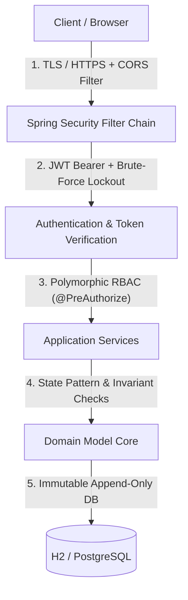

# 07 — Security Considerations & Production Hardening Report

## 1. Executive Summary & Threat Model

The **Intelligent IT Service Management (I-ITSM)** system handles sensitive operational data, including employee identities, internal infrastructure topologies, service dependency graphs, incident logs, and diagnostic attachments. 

To safeguard enterprise availability and confidentiality, I-ITSM incorporates a defense-in-depth security model across five architectural boundaries:



---

## 2. Authentication & Credential Architecture

### 2.1 Stateless JSON Web Tokens (JWT)
- **Token Format:** Cryptographically signed tokens using HMAC-SHA256 (`HS256`).
- **Stateless Verification:** `JwtAuthenticationFilter` intercepts inbound requests, extracts the `Authorization: Bearer <token>` header, parses claims, and populates the `SecurityContextHolder`.
- **Token Lifespan:** Default session validity is 24 hours (86,400 seconds), balancing frictionless evaluation with session boundaries.
- **Audience & Claims:** Encapsulates the user's primary email (subject) and GrantedAuthority role (`ROLE_EMPLOYEE`, `ROLE_TECHNICIAN`, `ROLE_ADMIN`).

### 2.2 Password Hashing
- Passwords are never stored in plaintext.
- Stored as one-way salted hashes using **BCrypt** with an adaptive work factor (cost 12):
  ```java
  @Bean
  public PasswordEncoder passwordEncoder() {
      return new BCryptPasswordEncoder(12);
  }
  ```
- Protects credentials against rainbow table lookup and offline dictionary attacks.

### 2.3 Account Lockout Mechanism (Brute-Force Protection)
- To defeat automated credential stuffing and brute-force dictionary attacks, the `User` domain model maintains:
  - `failedLoginAttempts`: Integer counter incremented on every failed authentication.
  - `lockedUntil`: Timestamp marking the end of the lockout period.
- **Lockout Policy:**
  - Upon **5 consecutive failed login attempts**, the account is locked for **15 minutes**.
  - Subsequent login attempts while locked return HTTP 403 Forbidden with the remaining lockout duration.
  - Upon any valid authentication, `failedLoginAttempts` resets to `0` and `lockedUntil` is cleared.

### 2.4 Account Recovery & Password Reset Lifecycle
- Self-service recovery follows a two-stage cryptographic verification procedure:
  1. **Token Generation:** The user enters their email; the system generates a secure 6-character verification code stored with a creation timestamp.
  2. **Expiration Window:** Reset tokens are valid for **15 minutes** only. Expired tokens are rejected (`BND-03`).
  3. **Single-Use Invalidation:** Once used to change credentials, the token is immediately wiped from the entity (`BND-02`).
  4. **Simulation Outbox:** For demo purposes, tokens are logged to an internal simulation outbox and auto-filled; in production, tokens are dispatched strictly via authenticated SMTP/SES with no client-side reflection.

---

## 3. Authorisation & Role-Based Access Control (RBAC)

### 3.1 Polymorphic Role Permissions
I-ITSM enforces permissions at both the domain model level and the API controller boundary:

| Role | Domain Class | System Capabilities | Restricted Actions |
|------|-------------|---------------------|-------------------|
| **Employee** | `Employee` | Report incidents, dictate voice descriptions, upload diagnostic media, view own tickets, add user comments, verify resolution, rate satisfaction (1-5) | Cannot assign tickets, edit SLA policies, change system strategies, or access admin analytics |
| **Technician** | `Technician` | View assignment queue, acknowledge, investigate, request info from employee, resolve incidents, reopen verified tickets | Cannot switch global strategies, delete users, or modify root service dependencies |
| **Administrator** | `Administrator` | Full system control: SLA target editor, service creation, category setup, technician capacity & availability controls, ticket reassignment, audit log inspection | Unrestricted |

### 3.2 Method-Level Security
All sensitive endpoints are guarded using Spring Security's `@PreAuthorize`:
```java
@PutMapping("/{id}/reassign")
@PreAuthorize("hasAnyRole('ADMIN', 'TECHNICIAN')")
public ResponseEntity<IncidentResponse> reassign(...) { ... }

@PutMapping("/strategies")
@PreAuthorize("hasRole('ADMIN')")
public ResponseEntity<StrategyConfigResponse> updateStrategy(...) { ... }
```

---

## 4. Input Validation & Domain Invariant Integrity

### 4.1 Strict Bean Validation
Every incoming request body is validated via Jakarta Bean Validation constraints (`@Valid`):
- `@NotBlank`, `@Email`: Enforces syntactically valid email formats.
- `@Size(min = 6)`: Enforces password complexity minimums.
- `@Min(1)`, `@Max(5)`: Guards satisfaction feedback ratings and service criticality bounds (`BND-01`).

### 4.2 State Machine Defensive Guards
State mutations bypass procedural setters and route exclusively through domain methods on `Incident.java`:
- If an actor attempts an illegal state transition (e.g. attempting to resolve a ticket in `NEW` state), the State pattern throws `InvalidStateTransitionException` (`T-02`, `T-03`, `T-04`).
- Procedural `if-else` checking is completely avoided in favor of polymorphic dispatch.

### 4.3 Workload Cap Enforcement
`Technician.incrementWorkload()` enforces internal capacity invariants:
- Attempts to allocate incidents beyond `maxWorkload` throw `TechnicianWorkloadExceededException` (`T-17`).
- Workload cannot decrement below zero (`T-18`).

---

## 5. SLA Clock Integrity & Fraud Defense

### 5.1 PENDING_USER State SLA Clock Pausing
A critical vulnerability in traditional ticketing systems is "SLA clock cheating," where technicians cannot pause response times while waiting for employee diagnostic feedback.

I-ITSM implements a formal state-driven solution:
1. When a technician requires clarification, calling `requestInfo()` transitions the incident to `PENDING_USER`.
2. The SLA status immediately switches to `SlaStatus.PAUSED`, recording `slaPausedAt = LocalDateTime.now()`.
3. Background schedulers (`SlaMonitorScheduler`) skip elapsed time calculations while in `PENDING_USER`.
4. When the employee responds via comment or `resumeWork()`, the ticket returns to `IN_PROGRESS`:
   - Exact paused duration is calculated: `pausedMinutes = Duration.between(slaPausedAt, now).toMinutes()`.
   - `totalSlaPausedMinutes` is incremented.
   - `resolutionDeadline` is dynamically extended by `pausedMinutes`.
   - Guaranteed by automated test `testPendingUserPausesSlaClockAndExtendsDeadline()` (`T-40`).

---

## 6. Immutable Audit Trail

### 6.1 Architectural Immutability
All state transitions, reassignments, escalations, and SLA pauses generate an `AuditLogEntry`:
- **Entity Immutability:** `AuditLogEntry.java` contains no public setter methods.
- **Repository Restriction:** `AuditLogEntryRepository` exposes only `save()`, `findByIncidentId()`, and `findAll()`.
- **Database Consistency:** Records are append-only. There are no API endpoints or services that perform update or delete operations on the audit repository.

---

## 7. Production Hardening Evolution Roadmap

While the capstone implementation provides a production-grade domain architecture, enterprise scaling requires the following evolutionary enhancements:

| Area | Capstone Implementation | Production Enterprise Target | Justification / Defense |
|------|------------------------|-----------------------------|-------------------------|
| **Evidence Storage** | Base64 strings (up to 25MB) stored in database | AWS S3 / Azure Blob Storage with Presigned Upload URLs | Eliminates database bloat; offloads binary streaming to distributed CDN object storage. |
| **Identity Management** | Local JPA `User` table with BCrypt | OpenID Connect (OIDC) / SAML 2.0 via Keycloak, Okta, or Azure AD | Enables enterprise Single Sign-On (SSO), hardware MFA, and central directory federation. |
| **Secret Management** | Local application properties | HashiCorp Vault / AWS Secrets Manager | Prevents credential exposure in code repositories; supports automatic secret rotation. |
| **API Protection** | Spring Security CORS & Lockout | Redis-backed distributed token bucket rate limiter | Protects against distributed denial-of-service (DDoS) across microservice nodes. |
| **Database Tier** | File-backed H2 / Dockerized PostgreSQL | AWS Aurora Multi-AZ PostgreSQL with read-replicas | Guarantees 99.999% high availability, automated backup snapshots, and zero-loss failover. |
