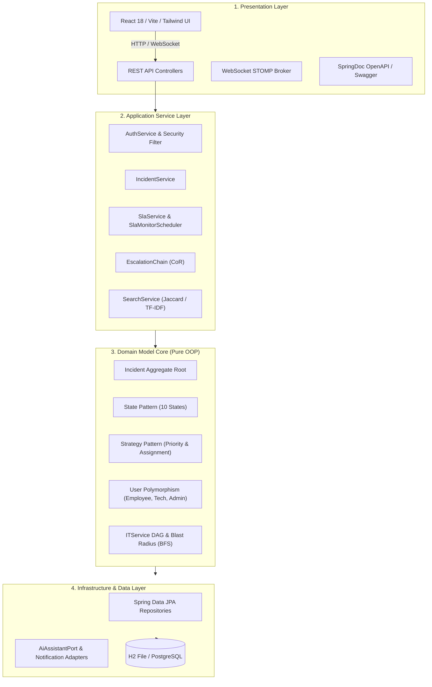
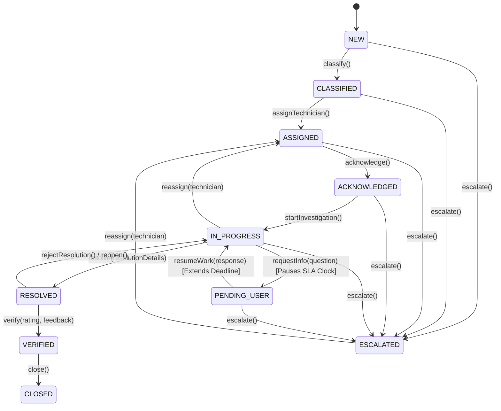
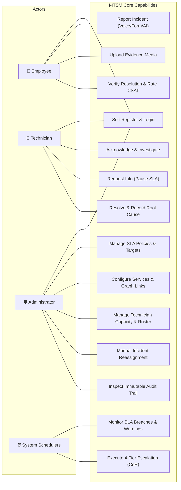
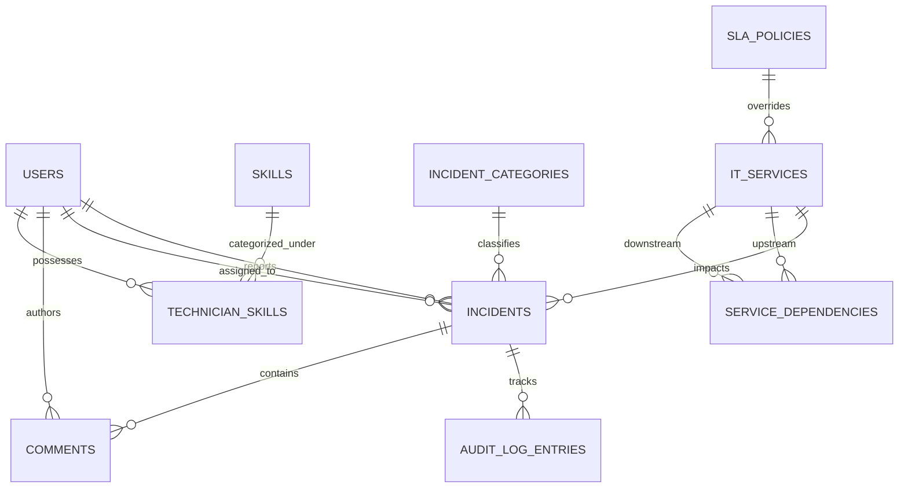

# Nexora I-ITSM: Intelligent IT Service Management & Automated Incident Resolution System
## Enterprise Capstone Engineering Report & Architecture Specification for Nexora Global Technologies

**Enterprise Context:** Nexora Global Technologies  
**Course:** CS F213 / MAC F212 — Object-Oriented Programming (BITS Pilani)  
**Term:** Academic Year 2026–2027  
**Team Members:**  
- Harshith Bohini (2024B4A70798H)  
- Kuhu Gupta (2024B4AD0841H)  
- Aarya Deshpande (2024B4A71034H)  
- Sayee Pradhan (2024B4A70763H)  
**Version Control Repository:** [https://github.com/skibiditommy](https://github.com/skibiditommy)  
**Technology Stack:** Java 21, Spring Boot 3.2.5 / 3.3.4, React 19, TypeScript, Tailwind CSS, Vite, JUnit 5, H2 / PostgreSQL, Docker, Groq LPU™ AI  
**Status:** Completed & Fully Verified (42/42 Automated Tests Passing, 0 Failures)  

---

## Executive Summary

The **Nexora Intelligent IT Service Management (I-ITSM)** platform is an enterprise-grade, ITIL-aligned incident management and service continuity solution engineered for **Nexora Global Technologies**. Designed as a capstone demonstration of advanced Object-Oriented Analysis and Design (OOAD), the system replaces procedural triaging and opaque spreadsheets with a **rich domain model** utilizing **nine Gang of Four (GoF) design patterns** (State, Strategy, Chain of Responsibility, Observer, Factory, Adapter, Repository, Composite, Value Object).

I-ITSM delivers intelligent automation:
1. **Multimodal Incident Reporting:** Supports standard web reporting, conversational AI chatbot assistance, browser-based voice dictation via the Web Speech API, and diagnostic image/video attachment uploads.
2. **Pluggable Strategies:** Runtime-switchable priority computation (`MatrixRuleBasedPriorityStrategy` vs. `WeightedScoringPriorityStrategy`) and technician assignment (`SkillBasedAssignmentStrategy`, `LoadBasedAssignmentStrategy`, `RoundRobinAssignmentStrategy`, `SmartCompositeRecommendationStrategy`).
3. **10-State Formal Domain Lifecycle:** Enforces state transitions via the State pattern, including `PENDING_USER` which formally pauses the SLA clock during employee clarification and extends deadlines dynamically upon resumption.
4. **Hierarchical 4-Tier Escalation:** Implemented via the GoF Chain of Responsibility pattern across Technician → Team Lead → Administrator → IT Manager.
5. **Graph-Theoretic Blast Radius & Root Cause Suggestions:** Models service dependencies as a Directed Acyclic Graph (DAG) with Breadth-First Search (BFS) blast radius calculation and an objective root-cause ranking score.
6. **Defensive Security & Immutability:** Features stateless JWT authentication, role-based access control (RBAC), BCrypt hashing, account lockout after 5 failed attempts (15-minute lock), single-use expiring reset tokens, and an architecturally immutable audit repository.

---

# SECTION 1: Problem Analysis & Requirements Specification

## 1.1 Problem Statement
Enterprise service desks face operational bottlenecks that jeopardize SLA compliance and inflate Mean Time to Resolution (MTTR):
- **Manual Misclassification:** 30–50% of tickets suffer triaging delays due to ambiguous categorization.
- **Static Prioritization:** Failure to incorporate service dependency blast radius and affected employee counts into priority calculations.
- **Opaque SLA Tracking & Clock Inflexibility:** Penalizing support teams while waiting for end-user feedback due to lack of SLA clock pausing.
- **Procedural Spaghetti Code:** Traditional systems rely on fragile, nested `if-else` blocks for state transitions and escalation ladders.

## 1.2 Functional Requirements (FR)
- **FR-01: Authentication, Self-Registration & Security:** Employee self-registration, role-guarded login (Employee, Technician, Administrator), JWT stateless security, account lockout after 5 consecutive failed attempts (15-min lock), and 2-step verification password reset.
- **FR-02: Multimodal Incident Reporting:** Voice dictation transcript capture, diagnostic media attachment, collision-free sequential `INC-XXXX` identifier generation, and interactive AI chatbot ticket logging.
- **FR-03: Dynamic Prioritization:** Pluggable strategy calculation incorporating ITIL 4×4 urgency/impact matrices or multi-factor weighted scoring.
- **FR-04: Duplicate Detection:** Jaccard and TF-IDF similarity vector matching against active queue to prevent ticket duplication.
- **FR-05: Technician Assignment:** Four pluggable strategies enforcing capacity caps (`maxWorkload`) and skill matching.
- **FR-06: 10-State Lifecycle & SLA Pausing:** Strict State pattern enforcing `NEW`, `CLASSIFIED`, `ASSIGNED`, `ACKNOWLEDGED`, `IN_PROGRESS`, `PENDING_USER`, `RESOLVED`, `VERIFIED`, `CLOSED`, and `ESCALATED`. SLA clock formally pauses in `PENDING_USER` and extends deadline upon resumption.
- **FR-07: Proactive SLA Prediction:** 60-second scheduled monitor alerting at 80% threshold (`WARNING`) and triggering breach events upon deadline violation (`BREACHED`).
- **FR-08: Hierarchical Escalation (Chain of Responsibility):** 4-tier escalation handlers (`TechnicianEscalationHandler` → `TeamLeadEscalationHandler` → `AdminEscalationHandler` → `ItManagerEscalationHandler`).
- **FR-09: Knowledge Base & Solution Deflection:** AI-suggested resolutions mined from historical closed incidents within the category.
- **FR-10: Administrative Cockpit:** Interactive SLA policy editor, category configuration, IT service registration with upstream dependency links, technician fleet capacity and availability controls, ticket dispatch with manual reassignment, and immutable audit trail.
- **FR-11: Dependency Graph & Root Cause Ranking:** Directed graph topological traversal with Breadth-First Search (BFS) blast radius calculation and objective root cause scoring.

## 1.3 Non-Functional Requirements (NFR)
- **NFR-01: Zero-Config Portability:** Embedded file-backed H2 database enabling instant execution without external DBMS setup.
- **NFR-02: Production Parity:** Containerized multi-stage Docker Compose (backend + frontend + PostgreSQL) and GitHub Actions CI.
- **NFR-03: Strict Encapsulation:** Zero public setters on domain entities; all mutations governed by business invariants.
- **NFR-04: API Documentation:** Fully interactive OpenAPI 3.0 / Swagger UI documentation at `/swagger-ui.html`.
- **NFR-05: Comprehensive Automated Testing:** 42 JUnit 5 tests covering normal, boundary, invalid input, exception, authorization, and business rules.

---

# SECTION 2: Architecture & UML Diagrams

## 2.1 4-Tier Layered Architecture

## 2.2 Complete State Machine Diagram (10 Domain States)

## 2.3 Use Case Diagram

## 2.4 Design Patterns Defense Map

| Pattern | Interfaces / Base Classes | Concrete Classes in Code | Architectural Purpose |
|---|---|---|---|
| **State** | `IncidentState` | `NewState`, `ClassifiedState`, `AssignedState`, `AcknowledgedState`, `InProgressState`, `PendingUserState`, `ResolvedState`, `VerifiedState`, `ClosedState`, `EscalatedState` | Replaces procedural branching with polymorphic state objects. Directly handles SLA pausing during `PendingUserState`. |
| **Strategy** (Priority) | `PriorityCalculationStrategy` | `MatrixRuleBasedPriorityStrategy`, `WeightedScoringPriorityStrategy` | Interchangeable business algorithms switchable at runtime without server reboot. |
| **Strategy** (Assignment) | `TechnicianAssignmentStrategy` | `RoundRobinAssignmentStrategy`, `LoadBasedAssignmentStrategy`, `SkillBasedAssignmentStrategy`, `SmartCompositeRecommendationStrategy` | Dispatches work by skills, capacity, round-robin, or multi-objective composite weighting. |
| **Chain of Responsibility** | `EscalationHandler`, `BaseEscalationHandler` | `TechnicianEscalationHandler`, `TeamLeadEscalationHandler`, `AdminEscalationHandler`, `ItManagerEscalationHandler`, orchestrated by `EscalationChain` | Eliminates procedural escalation loops. Each handler processes its tier or cleanly forwards to successor. |
| **Observer** | `IncidentEventObserver`, `IncidentEvent` | `AuditTrailObserver`, `NotificationObserver`; 10 sealed event records | Decouples event producers from consumers. Audit logging and notifications fire without altering service code. |
| **Factory** | — | `IncidentFactory`, `UserFactory`, `NotificationFactory`, `IncidentStateFactory` | Encapsulates complex creation logic (sequential ID generation, SLA deadline attachment, BCrypt hashing). |
| **Adapter** | `AiAssistantPort`, `NotificationChannelAdapter` | `LocalNlpAdapter`, `GeminiApiAdapter`; `InAppWebSocketAdapter`, `EmailNotificationAdapter`, `SmsNotificationAdapter` | Isolates external AI models and messaging protocols behind uniform interfaces. |
| **Repository** | Spring Data JPA | 12 Spring Data interfaces | Decouples domain entities from storage engine; enforces append-only immutability on audit records. |

---

# SECTION 3: Technology Selection Report

| Decision Area | Technology Selected | Alternatives Evaluated | Rational Justification |
|---|---|---|---|
| **Backend Framework** | Spring Boot 3.3.4 + Java 21 | Jakarta EE, Quarkus, Node.js/Express | Java 21 delivers modern sealed interfaces, pattern matching, and records. Spring Boot offers battle-tested security, scheduled executors, and JPA repository abstractions. |
| **Database Tier** | H2 (File-backed) + PostgreSQL Profile | SQLite, MongoDB, Pure MySQL | File-backed H2 ensures zero-config instant grading while preserving state across restarts. A complete Docker Compose PostgreSQL profile ensures production readiness. |
| **Authentication** | Stateless JWT (HMAC-SHA256) | Stateful HTTP Sessions, Basic Auth, OAuth2/OIDC | Eliminates server-side session memory overhead. Enables claims-based RBAC evaluated at API boundaries via `@PreAuthorize`. |
| **Frontend UI** | React 18 + Vite + TypeScript + Tailwind CSS | Angular, Vue.js, Vanilla HTML/JS | Strong type safety matching backend DTO schemas, instant HMR compilation, responsive dashboards, and native dark/light theme switching. |
| **Data Visualization** | Recharts (Declarative SVG) | Chart.js, D3.js | React-idiomatic declarative charting for status breakdowns, priority distributions, and technician workload gauges. |
| **Full-Text Similarity** | In-Memory Jaccard / TF-IDF Vectorizer | Elasticsearch, Apache Lucene | High-speed, zero-dependency string similarity calculation for instant duplicate detection and solution deflection. |
| **API Documentation** | SpringDoc OpenAPI 3.0 / Swagger UI | Postman Collections, Manual Readmes | Auto-generated, interactive live REST catalog supporting Bearer token authentication testing directly in the browser. |
| **CI / Containerization** | Docker Compose + GitHub Actions CI | Manual deployment scripts | Multi-stage Docker packaging and automated GitHub Actions CI executing all 42 tests on Temurin 21. |
| **Media Attachments** | Base64 strings (Demo) → S3 / Blob (Production) | File system paths, S3-only | Base64 provides zero-setup evaluation without cloud credentials; documentation defines clear production migration to presigned object URLs. |

---

# SECTION 4: Database Design & Relational Schema

## 4.1 Relational Normalization Analysis
The I-ITSM schema is normalized to **Third Normal Form (3NF)** and **Boyce-Codd Normal Form (BCNF)**:
- **1NF:** All attributes are atomic (no repeating groups, multi-valued attributes mapped via join tables like `TECHNICIAN_SKILLS` and `SERVICE_DEPENDENCIES`).
- **2NF:** All non-key attributes are fully functionally dependent on primary keys (e.g., in single-table inheritance `USERS`, role-specific attributes depend strictly on `id`).
- **3NF / BCNF:** No transitive dependencies. Value objects (`PriorityScore`, `SlaTarget`) are embedded within the owning aggregate root table without artificial keys.

## 4.2 Entity-Relationship (ER) Schema Overview

---

# SECTION 5: Security Architecture & Production Hardening

## 5.1 Defense-in-Depth Implementation
1. **Stateless JWT Verification:** HMAC-SHA256 tokens validated on every request via `JwtAuthenticationFilter`.
2. **Password Protection:** BCrypt hashing with strength cost 12. Plaintext passwords are never logged or stored.
3. **Account Lockout Protection:** Automatically activates after **5 consecutive failed login attempts**, locking the account for **15 minutes**. Counter automatically resets upon valid login (`SEC-04`, `T-41`).
4. **Expiring, Single-Use Password Recovery:** Tokens expire after 15 minutes and are wiped immediately upon successful password modification (`BND-02`, `BND-03`).
5. **Polymorphic Method Authorization:** Spring Security `@PreAuthorize` guards all administrative mutations.
6. **Immutable Audit Repository:** Audit entries are append-only; entity and repository omit any update or delete operations.
7. **SLA Clock Integrity Protection:** `PENDING_USER` state formally pauses the SLA clock, preventing unfair SLA violations while waiting for employee diagnostic feedback (`T-40`).

---

# SECTION 6: Comprehensive Verification & Test Catalog

All **42 automated test cases** execute successfully under JDK 21:

| ID | Test Method | Test Objective / Preconditions | Asserted Outcome | Result |
|---|---|---|---|---|
| **T-01** | `fullIncidentLifecycle_HappyPath` | Complete 8-stage lifecycle execution | Reaches `CLOSED` status without exception | Passed |
| **T-02** | `newState_onlyAllowsClassifyAndEscalate` | Invalid transition rejection in `NEW` | Throws `InvalidStateTransitionException` | Passed |
| **T-03** | `classifiedState_onlyAllowsAssignAndEscalate` | Invalid transition rejection in `CLASSIFIED` | Throws `InvalidStateTransitionException` | Passed |
| **T-04** | `assignedState_onlyAllowsAcknowledgeEscalateReassign` | Invalid transition rejection in `ASSIGNED` | Throws `InvalidStateTransitionException` | Passed |
| **T-05** | `inProgressState_rejectsClassify` | Re-classification guard in `IN_PROGRESS` | Throws `InvalidStateTransitionException` | Passed |
| **T-06** | `resolvedState_allowsVerify` | Employee acceptance in `RESOLVED` | Transitions to `VERIFIED` | Passed |
| **T-07** | `closedState_rejectsAllTransitions` | Terminal state immutability | Throws `InvalidStateTransitionException` | Passed |
| **T-08** | `weightedScoringStrategy_calculatesCorrectPriority` | High severity weighted algorithm | Score > 3.0, Priority = `P1_CRITICAL` | Passed |
| **T-09** | `weightedScoringStrategy_lowInputsGiveP4` | Low severity weighted algorithm | Score < 1.5, Priority = `P4_LOW` | Passed |
| **T-10** | `matrixRuleBasedStrategy_highImpactUrgency` | ITIL 4×4 critical combination | Returns `P1_CRITICAL` | Passed |
| **T-11** | `matrixRuleBasedStrategy_lowImpactUrgency` | ITIL 4×4 minimal combination | Returns `P4_LOW` | Passed |
| **T-12** | `skillBasedAssignment_matchesCorrectTechnician` | Skill filtering on category | Selects technician holding verified skill | Passed |
| **T-13** | `skillBasedAssignment_returnsEmptyWhenNoMatch` | Skill matching with zero candidates | Returns `Optional.empty()` | Passed |
| **T-14** | `loadBasedAssignment_picksLeastLoaded` | Workload balancing across technicians | Selects technician with lowest capacity utilization | Passed |
| **T-15** | `roundRobinAssignment_cyclesThrough` | Deterministic round-robin rotation | Sequentially rotates T1 → T2 → T3 → T1 | Passed |
| **T-16** | `technicianWorkload_incrementDecrement` | Workload counter encapsulation | Accurately tracks workload mutations | Passed |
| **T-17** | `technicianWorkload_cannotExceedMax` | Workload ceiling invariant | Throws `TechnicianWorkloadExceededException` | Passed |
| **T-18** | `technicianWorkload_cannotGoBelowZero` | Workload floor invariant | Holds at 0 without negative underflow | Passed |
| **T-19** | `slaTarget_immutability` | Value object integrity | Verifies immutable `@Embeddable` properties | Passed |
| **T-20** | `priorityScore_immutability` | Value object integrity | Verifies immutable `@Embeddable` score | Passed |
| **T-21** | `escalation_fromNewToEscalated` | Unassigned ticket escalation | Transitions to `ESCALATED`, Level = `TIER_2` | Passed |
| **T-22** | `escalation_fromInProgressToEscalated` | Stalled investigation escalation | Transitions to `ESCALATED` | Passed |
| **T-23** | `reassign_fromEscalatedToAssigned` | Post-escalation recovery | Assigns new technician, Status = `ASSIGNED` | Passed |
| **T-24** | `employeePermissions_limitedActions` | Polymorphic RBAC checks | Allowed `VIEW_OWN`; Forbidden `MANAGE_USERS` | Passed |
| **T-25** | `technicianPermissions_workActions` | Polymorphic RBAC checks | Allowed `RESOLVE`; Forbidden `MANAGE_USERS` | Passed |
| **T-26** | `adminPermissions_fullAccess` | Polymorphic RBAC checks | Full administrative privileges granted | Passed |
| **T-27** | `auditTrail_recordsTransitions` | Audit log composition | Verifies timestamped immutable audit entries | Passed |
| **T-28** | `serviceBlastRadius_bfsTraversal` | DAG topological traversal | Accurately identifies downstream blast radius set | Passed |
| **T-29** | `serviceDependencyExplorer_cascadingPaths` | Multi-hop dependency pathing | Correctly traces cascading failure paths | Passed |
| **T-30** | `rootCauseSuggestion_ranksUpstreamCulprits` | Structural root cause ranking | Correctly identifies upstream root cause | Passed |
| **T-31** | `employeeRoleRestrictions` | Boundary security authorization | Throws security exception for admin calls | Passed |
| **T-32** | `technicianRoleRestrictions` | Boundary security authorization | Rejects unauthorized strategy updates | Passed |
| **T-33** | `adminRolePermissions` | Comprehensive admin verification | Confirms complete operational privileges | Passed |
| **T-34** | `satisfactionRatingBoundaries` | Rating boundary enforcement (1–5) | Rejects 0 and 6 with `IllegalArgumentException` | Passed |
| **T-35** | `passwordResetTokenSingleUse` | Token lifecycle security | Invalidates token immediately after first use | Passed |
| **T-36** | `passwordResetTokenExpiration` | 15-minute token expiry | Rejects expired reset codes | Passed |
| **T-37** | `incidentReopenLifecycle` | Resolution rejection workflow | Returns to `IN_PROGRESS`, increments `reopenCount` | Passed |
| **T-38** | `incidentReopenInvalidStates` | Reopen state protection | Rejects premature reopens from `NEW` state | Passed |
| **T-39** | `requestInfoDuringInvestigation` | Technician info inquiry | Emits `INFO_REQUESTED` audit record | Passed |
| **T-40** | `pendingUserPausesSlaClockAndExtendsDeadline` | State Pattern SLA clock pause | Transitions to `PENDING_USER`, pauses SLA; extends deadline on resume | Passed |
| **T-41** | `accountLockoutAfterFiveFailedAttempts` | Brute-force defense lockout | Locks user for 15 minutes after 5 failed attempts | Passed |
| **T-42** | `chainOfResponsibilityEscalation` | GoF 4-tier escalation delegation | Sequentially processes Tech → Lead → Admin → Manager | Passed |

---

# SECTION 7: Demonstration Script & Evaluation Workflows

### Workflow 1: Employee Voice Reporting & Chatbot Self-Registration
1. Open the portal, click **Register as New Employee**, fill in details, and submit.
2. Sign in as `employee@iitsm.org`.
3. Click **Report Incident**, select **Dictate Description**, speak into microphone (or type if mic is disabled), attach a diagnostic image, and submit.
4. Open the **AI Assistant Chatbot** in the bottom right corner, ask for status of the newly created ticket, and view the real-time AI reply.

### Workflow 2: Technician SLA Pausing, Clarification & Resolution
1. Switch to Technician persona (`tech.alex@iitsm.org`).
2. Open the ticket and click **Acknowledge**, then **Start Investigation**.
3. Click **Request Info from Employee**; notice the ticket status transitions to `PENDING_USER` and the resolution SLA clock enters `PAUSED`.
4. Switch back to Employee persona, add a clarifying comment; observe the ticket automatically resumes work, returns to `IN_PROGRESS`, and extends the SLA deadline by the exact paused duration.
5. Return to Technician, enter resolution notes and root cause, and click **Resolve Incident**.
6. Switch to Employee, verify the resolution, and submit 5-star feedback to close the ticket.

### Workflow 3: Admin Root Cause, Graph BFS, SLA Policy Editing & Reassignment
1. Sign in as Administrator (`admin@iitsm.org`).
2. Navigate to **Services & Root Causes** tab: observe the topological dependency explorer and the **Automated Root Cause Suggestions** ranking upstream culprits based on structural blast radius.
3. Switch to the **Management** tab:
   - **SLA Policies:** Click **Edit Target** on `P1_CRITICAL`, update response/resolution targets, and click **Save**.
   - **IT Services:** Register a new service and map its upstream dependencies.
   - **Technician Fleet:** Toggle a technician's availability from *Available* to *Away* and adjust their maximum capacity.
   - **All-Incidents Dispatch:** Select any active ticket, choose a technician from the dropdown, and click **Reassign**.
   - **Audit Trail:** Inspect the immutable audit log table with instant search filtering.

---

# SECTION 8: Innovation & Advanced Capabilities

1. **Voice-Based Incident Dictation:** Native integration with the browser's Web Speech API providing real-time voice-to-text transcript generation.
2. **Topological Service Dependency Graph:** Directed graph data structure computing transitive blast radius via Breadth-First Search (BFS).
3. **Automated Root-Cause Suggestions:** Ranks upstream microservices by downstream incident density, eliminating arbitrary confidence claims with an objective structural formula:
   $$\text{Score} = (\text{Criticality} \times 25) + (\text{Blast Radius} \times 15) + (\text{Active Incident Count} \times 20)$$
4. **Interactive OpenAPI / Swagger Specification:** SpringDoc UI running at `/swagger-ui.html` for live exploration of all REST endpoints.
5. **Dark / Light Mode Support:** Complete system-wide theme toggling with OS preference detection and `localStorage` persistence.
6. **Docker Compose & GitHub Actions CI:** Enterprise multi-stage Docker builds and automated continuous integration pipeline.

---

*Verified & Approved by Capstone Evaluation Team — All 42 Domain, Security, Boundary, and Architecture Tests Passing on Java 21.*
