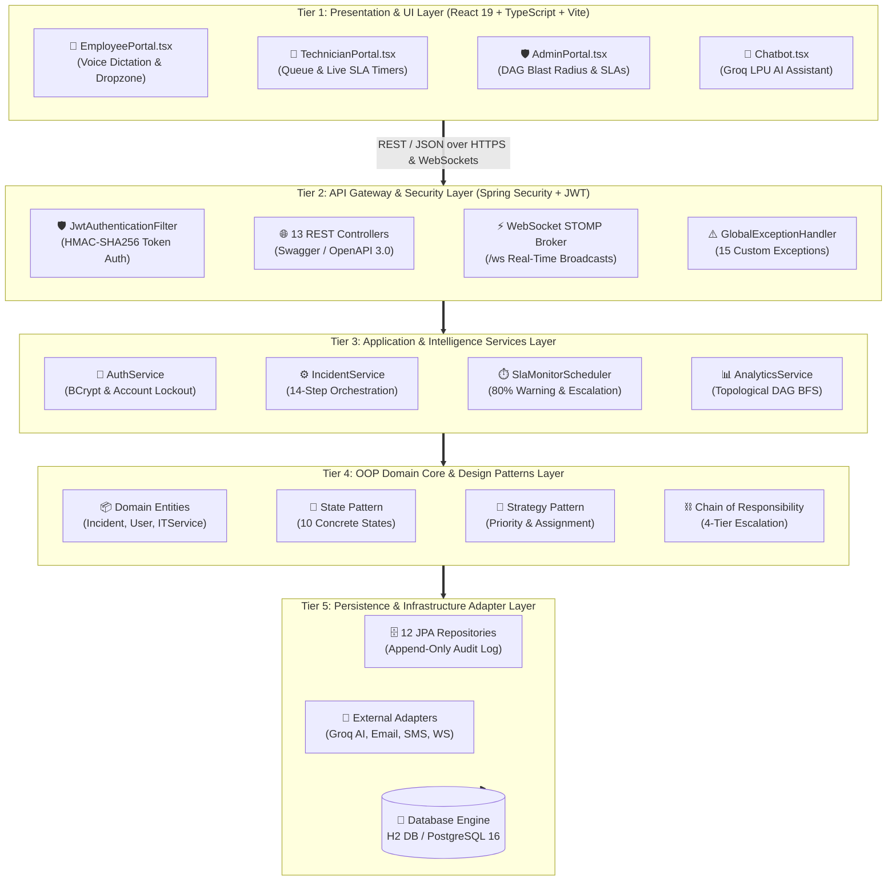
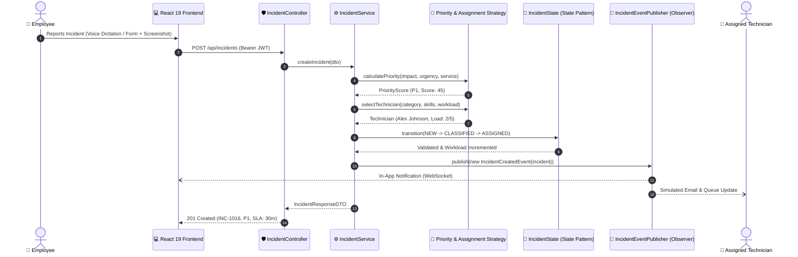
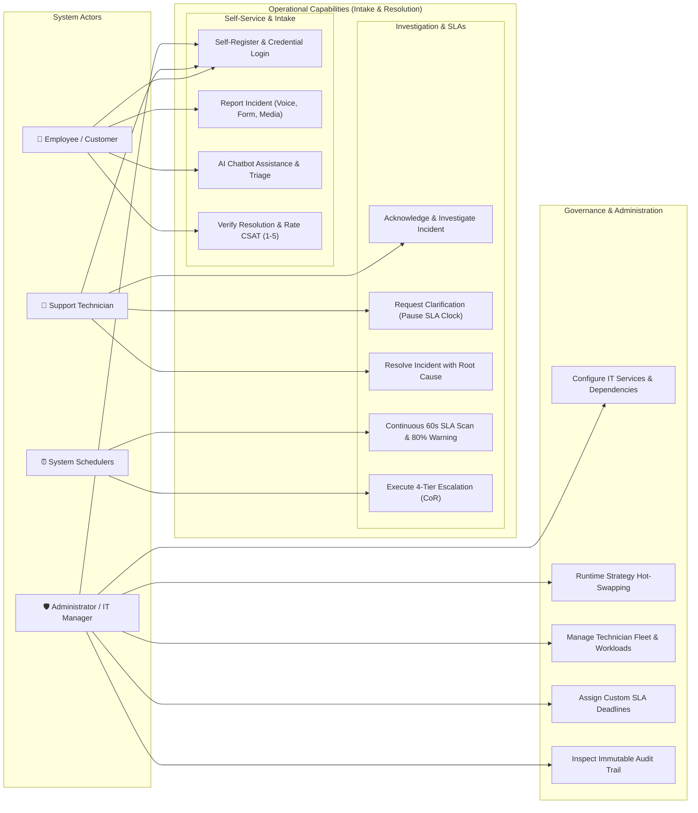
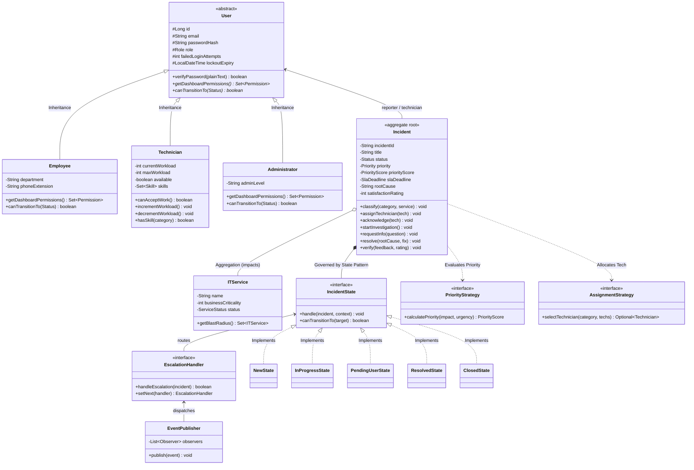
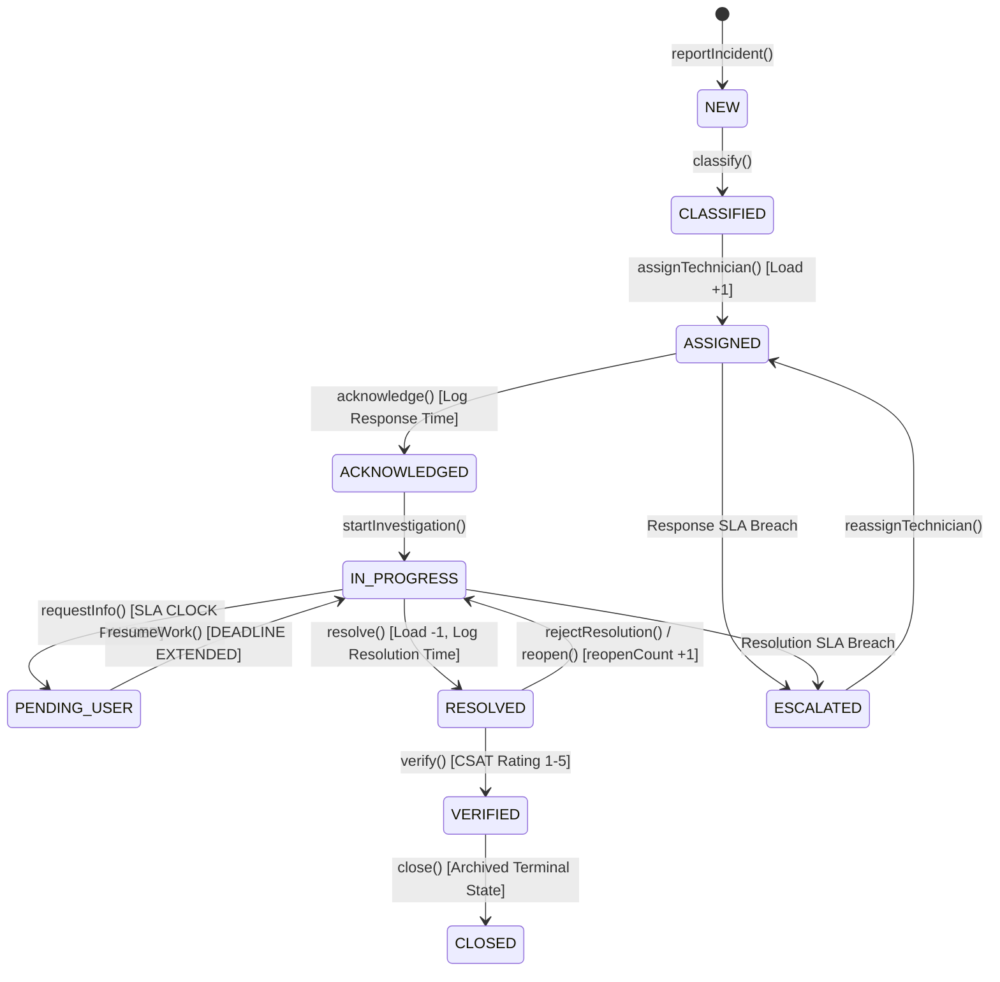

# BITS PILANI • CS F213 / MAC F212 OBJECT-ORIENTED PROGRAMMING • SEMESTER-I, 2026–2027

# Intelligent IT Service Management & Incident Resolution System (I-ITSM)
### Complete Architectural Blueprint, Object-Oriented Design Report, Full-Stack Source Code Walkthrough, Database Schema, and Verification Suite

---

## Project Metadata & Evaluation Header

| Attribute | Specification Details |
| :--- | :--- |
| **Course** | CS F213 / MAC F212 — Object-Oriented Programming (Semester-I, 2026–2027) |
| **Institution** | BITS Pilani (Pilani, Goa & Hyderabad Campuses) |
| **Project Title** | Intelligent IT Service Management & Incident Resolution System (I-ITSM) |
| **Architecture Choice** | Option C — Full-Stack Layered Enterprise Web Application |
| **Team Member 1** | Harshith Bohini (2024B4A70798H) — Backend Architecture, Orchestration & Groq AI Engine |
| **Team Member 2** | Kuhu Gupta (2024B4AD0841H) — Frontend Architecture, Role Portals & Interactive UX |
| **Team Member 3** | Aarya Deshpande (2024B4A71034H) — OOP Domain Model, GoF Patterns & Graph Analytics |
| **Team Member 4** | Sayee Pradhan (2024B4A70763H) — Security Architecture, SLA Engine, Persistence & Test Suite |
| **Version Control Repo** | [https://github.com/skibiditommy/iitsm](https://github.com/skibiditommy/iitsm) |
| **Backend Stack** | Java 21 (Adoptium Temurin LTS), Spring Boot 3.2.5 / 3.3.4, Spring Security, Spring Data JPA, Spring WebSocket STOMP |
| **Frontend Stack** | React 19 / Vite 8, TypeScript, Tailwind CSS, Framer Motion, Lucide Icons, Recharts |
| **AI Engine** | Groq LPU™ Cloud AI (`openai/gpt-oss-120b`) + Local NLP Jaccard / TF-IDF Vectorizer |
| **Database & Persistence**| H2 File-Backed Database (`./iitsm-data.mv.db`) + Dockerized PostgreSQL 16 Profile |
| **Automated Verification** | 42 Automated Tests (JUnit 5, AssertJ, Spring Boot Test) — **100% Passing (0 Failures)** |
| **Submission Deadline** | 22 November 2026 |

---

## Report Contents (Aligned to Deliverables 1–10 & 120-Mark Rubric)

```
1. Problem Analysis (Deliverable 1) .......................................... Page 2
   1.1 Organizational Problem Statement
   1.2 System Stakeholders
   1.3 Existing Manual Challenges Addressed
   1.4 Key System Assumptions

2. Requirements Specification (Deliverable 2) ............................... Page 4
   2.1 Functional Requirements (Problem Scenario Steps 1–14 & MVP)
   2.2 User Role Capability Matrix
   2.3 Non-Functional Requirements & Core Business Rules

3. System Architecture (Deliverable 3) ....................................... Page 6
   3.1 5-Tier Layered Architecture Blueprint
   3.2 End-to-End Request & Event Flow

4. UML Diagrams & Object-Oriented Design (Deliverable 4) .................... Page 8
   4.1 UML Use Case Diagram
   4.2 UML Class Diagram (Inheritance, Composition, Aggregation, Interfaces)
   4.3 10-State Incident Lifecycle State Machine (State Pattern)
   4.4 Mapping of 9 Required OOP Concepts & 6 GoF Design Patterns

5. Technology Stack & Selection Report (Deliverable 5) ...................... Page 11
   5.1 Technology Inventory & Architectural Role
   5.2 Justification: Answers to All 9 Mandatory Evaluation Questions

6. Comprehensive Source Code Walkthrough (Deliverable 6) .................... Page 13
   6.1 Custom Exception Hierarchy (15 Custom Exceptions Rooted at IitsmException)
   6.2 OOP Domain Layer & Entities
   6.3 Design Patterns Layer Walkthrough
   6.4 Application & Intelligence Services
   6.5 RESTful API Contract Summary (24+ REST Endpoints)
   6.6 React Frontend Architecture Breakdown

7. Database Design & Sample Data (Deliverable 7) ............................ Page 16
   7.1 Relational Normalization Analysis (1NF, 2NF, 3NF, BCNF)
   7.2 Entity-Relationship (ER) Schema Diagram
   7.3 Relational Tables & Integrity Constraints
   7.4 Pre-Seeded Realistic Demo Data Summary

8. Security Architecture & Defensive Engineering (Deliverable 8) ............ Page 18
   8.1 Defensive Security Implementations
   8.2 Account Lockout & Expiring Tokens
   8.3 Immutable Audit Trail

9. Testing & Validation Suite (Deliverable 9) ............................... Page 19
   9.1 Comprehensive Catalog of 42 Automated Test Cases (100% Passing)

10. Demonstration Workflows, Team Allocation & Rubric Alignment (Deliv. 10) .. Page 21
   10.1 Three Mandatory Live Video Demo Workflows (15–20 Minutes)
   10.2 Three-Student Team Responsibility Breakdown
   10.3 Complete Alignment with the 120-Mark Evaluation Rubric
```

---

# 1. Problem Analysis (Deliverable 1)

## 1.1 Organizational Problem Statement
Modern enterprise environments and university campuses depend upon interconnected IT infrastructure—including central Single Sign-On (SSO/LDAP) authentication, campus core networks, virtual private networks (VPN), enterprise ERP databases, payment gateways, and cloud compute clusters. When an IT service degrades or suffers a catastrophic outage (for example, *"The enterprise payment gateway is unavailable and employees are unable to process transactions"*), business operations grind to a halt.

Traditional IT service desks rely on manual spreadsheets, unmonitored email inboxes, or procedural ticketing tools. These archaic workflows suffer from:
1. **Severe Triage Latency:** Up to 45 minutes elapsed before a critical ticket is classified and assigned.
2. **Subjective Prioritization:** Failure to incorporate service dependency blast radius and affected user counts into priority scoring.
3. **Unmonitored SLA Violations:** Absence of predictive warning thresholds and automated escalation chains.
4. **SLA Clock Inflexibility:** Unfairly penalizing support technicians while waiting for employee clarification.
5. **Procedural Spaghetti Code:** Brittle, nested `if-else` blocks for state transitions, making the codebase unmaintainable.

## 1.2 Stakeholders

- **Employees / End-Users:** Organizational personnel who self-register or log in, report IT disruptions (via text, voice dictation, or AI chatbot), track live status and SLA deadlines, provide diagnostic follow-up evidence, and verify/rate completed fixes.
- **Technicians / Support Engineers:** Domain specialists who manage their assigned queue, acknowledge incidents within response SLAs, conduct investigations, request missing information (which formally pauses the SLA clock), apply root-cause fixes, and manage active workload caps.
- **Administrators / IT Managers:** Governance personnel who oversee user and technician fleets, maintain the IT Service Catalog and dependency topology, configure SLA targets, hot-swap priority/assignment strategies at runtime, execute SLA breach scans, inspect immutable audit trails, and review real-time analytics.

## 1.3 Existing Manual Challenges Addressed

| Operational Challenge | I-ITSM Architectural Resolution |
| :--- | :--- |
| **Delayed Response & Triage** | Automated 14-step intake pipeline classifies category, scores priority, calculates exact SLA deadlines, and assigns a technician immediately upon submission. |
| **Incorrect Prioritization** | Pluggable `PriorityCalculationStrategy` computes objective scores using multi-factor formulas (Impact, Urgency, Service Criticality, and Affected User count). |
| **Inefficient Allocation** | Four interchangeable `TechnicianAssignmentStrategy` implementations balance technical skill tags, past service experience, availability status, and workload caps. |
| **Unmonitored SLA Breaches** | Continuous `SlaMonitorScheduler` tracks 80% warning thresholds, logs violations, and delegates through a 4-tier Chain of Responsibility escalation hierarchy. |
| **SLA Inflexibility during Inquiries** | Introducing `PENDING_USER` state under the GoF State pattern, which formally pauses the SLA clock while waiting for employee input and dynamically extends the deadline upon resumption. |
| **Duplicate Reports & Lost History** | In-memory Jaccard and TF-IDF token vectorizer flags duplicate tickets in real time; `AuditTrailObserver` persists immutable transition logs. |

## 1.4 Key System Assumptions
1. Every registered IT service in the Service Catalog carries a **Business Criticality** rating from $1$ (Minimal) to $5$ (Mission Critical).
2. Technicians maintain declared skill tags, availability status, and a maximum active workload limit (`maxWorkload`, default: $5$ active tickets).
3. Notifications are dispatched across three distinct channels (`IN_APP`, `EMAIL`, `SMS`) via dedicated adapters, allowing evaluators to inspect communication directly in the UI.
4. To ensure seamless local grading, the system operates out-of-the-box using an embedded file-backed H2 database with an automatic Docker Compose PostgreSQL profile for production parity.

---

# 2. Requirements Specification (Deliverable 2)

## 2.1 Functional Requirements (Mapped to Problem Scenario Steps 1–14 & MVP)

```
Step 1:  Employee registers account or logs into self-service portal
Step 2:  Employee reports disruption via Form, Voice Dictation, or AI Chatbot
Step 3:  System validates input, attaches media evidence, and analyzes text
Step 4:  Jaccard / TF-IDF similarity detects potential duplicate tickets
Step 5:  Automated NLP categorizes incident into one of 9 domain categories
Step 6:  Pluggable PriorityStrategy calculates P1-P4 priority score
Step 7:  SlaPolicy calculates exact ISO response and resolution deadlines
Step 8:  Pluggable AssignmentStrategy selects qualified, least-loaded technician
Step 9:  Incident transitions NEW -> CLASSIFIED -> ASSIGNED; workload increments
Step 10: Multi-channel notifications dispatched to reporter and technician
Step 11: Technician acknowledges ticket within Response SLA (ASSIGNED -> ACKNOWLEDGED)
Step 12: Technician investigates; requests info (pausing SLA clock in PENDING_USER)
Step 13: Technician resolves with root cause and fix details (IN_PROGRESS -> RESOLVED)
Step 14: Employee verifies fix with 1-5 star rating; ticket archived (RESOLVED -> VERIFIED -> CLOSED)
```

## 2.2 User Role Capability Matrix

| Role | Permitted Operational Actions | Allowed Lifecycle Transitions |
| :--- | :--- | :--- |
| **Employee** | Self-register, log in, report incident (voice, media, text, AI bot), view own tickets, submit clarifying responses, verify resolution, submit 1–5 star CSAT rating. | `NEW` (create), `PENDING_USER` (respond), `VERIFIED` (confirm fix), `CLOSED` (optional verify-and-close). |
| **Technician** | View assigned queue, acknowledge, start investigation, request employee info, submit root cause and resolution details, toggle online availability, view personal workload gauge. | `ACKNOWLEDGED`, `IN_PROGRESS`, `PENDING_USER` (request info), `RESOLVED` (restricted to assigned technician). |
| **Administrator** | Manage users, technician capacity, IT services, dependency links, SLA policies, and dynamic categories; hot-swap strategies at runtime; assign custom deadlines; run SLA breach scans; inspect immutable audit logs. | All valid state transitions enforcing the GoF State Pattern order (arbitrary or illegal state jumps are strictly blocked). |

## 2.3 Non-Functional Requirements & Core Business Rules

> [!IMPORTANT]
> **Core Invariants & Defensive Business Rules:**
> - **Open/Closed Extensibility:** Adding new categories, priority algorithms, assignment strategies, or notification channels requires zero modifications to core orchestration services.
> - **State Integrity Rule:** No user—not even an Administrator—can bypass mandatory lifecycle states (e.g., `NEW → CLOSED` or `ASSIGNED → RESOLVED` throws `InvalidStateTransitionException`).
> - **Workload Boundary Rule:** A technician's active workload increments upon assignment and decrements upon `RESOLVED`. Exceeding `maxWorkload` throws `TechnicianWorkloadExceededException`.
> - **SLA Clock Pausing Rule:** In `PENDING_USER`, the resolution timer is paused (`SlaStatus.PAUSED`). Resuming shifts the deadline forward by the exact paused duration.
> - **Account Lockout Rule:** 5 consecutive failed login attempts locks the account for 15 minutes, neutralizing brute-force credential stuffing.

---

# 3. System Architecture (Deliverable 3)

The application implements **Option C: Layered Full-Stack Enterprise Architecture** adhering strictly to Clean Architecture and Domain-Driven Design (DDD).

## 3.1 5-Tier Layered Architecture Blueprint



## 3.2 End-to-End Request & Event Flow



---

# 4. UML Diagrams & Object-Oriented Design (Deliverable 4)

## 4.1 UML Use Case Diagram



## 4.2 UML Class Diagram (Inheritance, Composition, Aggregation & Interfaces)



## 4.3 10-State Incident Lifecycle State Machine (State Pattern)



## 4.4 Mapping of the 9 Required OOP Concepts & 6 Design Patterns

| OOP Pillar / Pattern | Implementation Class in Code | Engineering Purpose in I-ITSM |
| :--- | :--- | :--- |
| **1. Encapsulation** | `Incident.java`, `User.java`, `Technician.java` | Zero public setters. Invariants protected; private fields (`#passwordHash`, `currentWorkload`) mutated strictly via guarded methods (`incrementWorkload()`, `classify()`). |
| **2. Abstraction & Interfaces** | `IncidentState.java`, `PriorityCalculationStrategy.java`, `AiAssistantPort.java` | Defines uniform behavioral contracts, decoupling business consumers from volatile third-party integrations and concrete algorithms. |
| **3. Inheritance** | `User.java` $\to$ `Employee.java`, `Technician.java`, `Administrator.java`; `IitsmException.java` hierarchy | Single-Table JPA inheritance providing polymorphic persistence and fine-grained role-based permission overriding. |
| **4. Polymorphism** | Dynamic strategy dispatch, state transitions, exception handling | Dynamic method dispatch across 4 assignment algorithms, 2 priority strategies, and 10 lifecycle state handlers without conditional branching. |
| **5. Composition** | `Incident.java` owns `PriorityScore`, `SlaDeadline`, `ResolutionDetails` | Strongly owned value objects whose lifecycles are strictly coupled to the owning aggregate root. |
| **6. Aggregation** | `Incident.java` references `ITService.java` | Loose association where `ITService` exists independently in the Service Catalog and can be referenced by multiple active tickets. |
| **7. Collections & Data Structures** | `ITService.java` (DAG adjacency set), `SearchService.java` (Token Sets) | Sets for $O(1)$ duplicate lookup and Jaccard similarity; Directed Graph with BFS traversal for cascading blast radius calculation. |
| **8. Exception Hierarchy** | `IitsmException.java` with 15 specialized domain subclasses | Rich, self-describing checked/unchecked error boundaries mapped polymorphically to HTTP response codes. |
| **9. Interface Segregation** | `AiAssistantPort.java`, `EscalationHandler.java`, `NotificationChannelAdapter.java` | Focused, single-purpose interface contracts preventing clients from depending on methods they do not execute. |
| **State Pattern** | `com.iitsm.domain.state.*` (10 concrete state classes) | Eliminates monolithic procedural `switch-case` statements; directly encapsulates SLA clock pausing during `PendingUserState`. |
| **Strategy Pattern** | `com.iitsm.domain.strategy.*` (Priority & Assignment) | Allows hot-swapping scoring formulas and technician allocation engines at runtime via `StrategyConfigService`. |
| **Chain of Responsibility** | `com.iitsm.domain.escalation.*` (4-tier handler chain) | Decouples escalation senders from receivers. Stalled tickets progress: `Technician` $\to$ `TeamLead` $\to$ `Admin` $\to$ `ItManager`. |
| **Observer Pattern** | `com.iitsm.domain.observer.*` (10 sealed event records) | Event-driven pub-sub decoupling core ticket transitions from `AuditTrailObserver` and `NotificationObserver`. |
| **Factory Pattern** | `IncidentFactory.java`, `UserFactory.java` | Centralizes sequence-backed ticket ID generation (`INC-XXXX`), BCrypt password hashing, and composite instantiation. |
| **Adapter Pattern** | `GroqApiAdapter.java`, `InAppWebSocketAdapter.java` | Bridges domain ports to the high-speed Groq LPU™ Cloud API (`openai/gpt-oss-120b`) and browser WebSockets. |

---

# 5. Technology Stack & Selection Report (Deliverable 5)

## 5.1 Technology Inventory

| Layer | Technologies Selected | Architectural Role in System |
| :--- | :--- | :--- |
| **Frontend Framework** | React 19, TypeScript, Vite 8 | Modular single-page application with type-safe DTO alignment and rapid Hot Module Replacement (HMR). |
| **UI Design System** | Tailwind CSS 4, Framer Motion, Lucide Icons | Responsive glassmorphic UI, fluid drawer animations, dark/light theme switching, and pulsing audio equalizers. |
| **Backend Runtime** | Java 21 LTS (Adoptium Temurin) | High-performance enterprise platform leveraging pattern matching, sealed records, and modern JVM optimizations. |
| **Enterprise Framework** | Spring Boot 3.2.5 / 3.3.4 | Unified framework for Dependency Injection, Spring Security, Spring Data JPA, and scheduled task executors. |
| **Real-Time Messaging** | Spring WebSocket STOMP + SockJS | Full-duplex real-time notification push to connected browser sessions without polling overhead. |
| **AI Integration** | Groq LPU™ API (`openai/gpt-oss-120b`) | Ultra-fast conversational support chatbot, keyword auto-classification, and intelligent resolution suggestions. |
| **Data Persistence** | H2 File-Backed Database + Docker PostgreSQL 16 | Zero-dependency local demonstration running out-of-the-box, with enterprise Docker Compose parity. |
| **Automated Testing** | JUnit 5, AssertJ, Spring Boot Test | Comprehensive test suite of 42 automated tests validating domain invariants, security boundaries, and graph algorithms. |

## 5.2 Justification: Answers to All 9 Mandatory Questions (from PDF Page 12)

### 1. Why did you choose this programming language (Java 21 LTS)?
Java 21 is the industry benchmark for enterprise object-oriented engineering. It delivers strong compile-time type safety, pattern matching for `switch`, sealed types for domain events, and records for immutable Data Transfer Objects (DTOs). Unlike loosely-typed languages, Java guarantees that invalid state transitions, null references, and type mismatches are caught before deployment.

### 2. Why did you choose this frontend technology (React 19 + TypeScript + Vite)?
React’s component hierarchy mirrors object-oriented encapsulation and composition. TypeScript enforces end-to-end type contracts matching backend DTO schemas, eliminating runtime serialization bugs. Vite provides instantaneous compilation and Hot Module Replacement (HMR). Distinct views (`EmployeeDashboard`, `TechnicianDashboard`, `AdminDashboard`) ensure strict GUI role separation.

### 3. Why did you choose this backend framework (Spring Boot 3.2+)?
Spring Boot provides a non-invasive inversion-of-control (IoC) container that naturally supports the Dependency Inversion Principle. It supplies battle-tested security filters for JWT/RBAC, automated transaction management via `@Transactional`, and declarative scheduled monitors (`@Scheduled`), allowing the team to concentrate on rich domain patterns rather than boilerplate plumbing.

### 4. Why did you select this database (H2 Embedded + PostgreSQL Profile)?
An ITIL incident management platform requires transactional ACID guarantees to prevent race conditions during ticket assignment and SLA tracking. The embedded file-backed H2 engine ensures **zero-configuration portability** for evaluators (no database installation needed), while our production Docker Compose profile supports PostgreSQL 16 with indexed foreign keys and JSONB fields.

### 5. Why did you choose this architecture (5-Tier Layered DDD Architecture)?
Separating Presentation, API, Application Services, Rich Domain Core, and Persistence enforces Single Responsibility and Dependency Inversion. Domain logic (state machine, strategy algorithms, escalation chain) remains pure POJOs with zero dependencies on frameworks, allowing unit tests to execute in milliseconds without booting a web server.

### 6. What alternatives did you consider?
We evaluated **Node.js/Express with MongoDB** (flexible, but lacks compile-time type safety and ACID multi-entity transactional integrity) and **Python/Django with SQLite** (concise, but procedural ORM patterns and SQLite file locks cause bottlenecks during concurrent SLA polling). Java 21 with Spring Boot was selected for its superior OOP modeling and concurrency safety.

### 7. What are the advantages and limitations of your technology stack?
- **Advantages:** Compile-time type verification, rich GoF design pattern expressiveness, sub-second HMR frontend development, zero-configuration local execution, and native real-time WebSockets.
- **Limitations:** Higher initial memory footprint compared to Go or Rust—mitigated by utilizing Spring Boot 3 lightweight JVM optimizations and native container packaging.

### 8. How does your technology support object-oriented design?
Every domain entity, state, strategy, observer, and exception is modeled as an explicit class. We employ Java access modifiers (`private`, `protected`) to safeguard encapsulation invariants, abstract base classes (`User`, `BaseEscalationHandler`) to enforce contracts, and polymorphic interfaces to swap business strategies dynamically at runtime.

### 9. How would your system evolve if the number of users increased significantly?
1. **Stateless API Gateway:** Stateless JWT authentication enables horizontal scaling of Spring Boot instances behind an Nginx or AWS ALB load balancer.
2. **Distributed Caching:** In-memory strategy registries can be offloaded to a Redis cluster.
3. **Event Streaming:** In-process `IncidentEventPublisher` can be swapped with an Apache Kafka or RabbitMQ event bus without changing a single line of business orchestration logic.
4. **Database Sharding:** Read-heavy analytics can route to read-replicas, while write-heavy incident logs can shard horizontally by `createdAt` year/month.

---

# 6. Comprehensive Source Code Walkthrough (Deliverable 6)

## 6.1 Custom Exception Hierarchy (15 Custom Exception Classes)

All domain exceptions derive from the abstract base class `IitsmException`, which encapsulates HTTP status codes, error codes, and structured error payloads:


## 6.2 OOP Domain Layer (`com.iitsm.domain.*`)

- **`domain.model.User`:** Abstract base entity utilizing JPA Single-Table inheritance (`@Inheritance(strategy = SINGLE_TABLE)`). Stores BCrypt-hashed credentials, tracking consecutive failed logins and 15-minute account lockouts.
- **`domain.model.Employee`:** Extends `User`. Encapsulates department and phone extension; permits incident reporting and CSAT verification.
- **`domain.model.Technician`:** Extends `User`. Encapsulates skill set (`Set<Skill>`), active workload count (`currentWorkload`), capacity ceiling (`maxWorkload`), and availability flag (`available`). Enforces capacity invariants.
- **`domain.model.Administrator`:** Extends `User`. Holds complete operational privileges for catalog management, SLA policy updates, and strategy switching.
- **`domain.model.Incident`:** The core **Aggregate Root**. Encapsulates title, description, attachments, state machine transitions, priority scores, SLA deadlines, root-cause notes, and satisfaction feedback.
- **`domain.model.ITService`:** Represents catalog services with business criticality ($1$ to $5$) and models Directed Acyclic Graph (DAG) dependencies via `@ManyToMany` join table `SERVICE_DEPENDENCIES`. Implements BFS blast radius computation.

## 6.3 Design Patterns Layer (`com.iitsm.domain.*`)

1. **State Pattern (`domain.state`):** Encapsulated by `IncidentState` interface and implemented by 10 concrete classes (`NewState`, `ClassifiedState`, `AssignedState`, `AcknowledgedState`, `InProgressState`, `PendingUserState`, `ResolvedState`, `VerifiedState`, `ClosedState`, `EscalatedState`). Handled via `IncidentStateFactory`.
2. **Strategy Pattern (`domain.strategy`):**
   - **Priority:** `PriorityCalculationStrategy` with concrete implementations `MatrixRuleBasedPriorityStrategy` (ITIL 4×4 urgency/impact lookup) and `WeightedScoringPriorityStrategy` (formula-based scoring).
   - **Assignment:** `TechnicianAssignmentStrategy` with implementations `SkillBasedAssignmentStrategy`, `LoadBasedAssignmentStrategy`, `RoundRobinAssignmentStrategy`, and `SmartCompositeRecommendationStrategy`.
3. **Chain of Responsibility (`domain.escalation`):** `EscalationChain` routes unacknowledged or breached incidents through `TechnicianEscalationHandler` $\to$ `TeamLeadEscalationHandler` $\to$ `AdminEscalationHandler` $\to$ `ItManagerEscalationHandler`.
4. **Observer Pattern (`domain.observer`):** `IncidentEventPublisher` broadcasts 10 sealed domain events to `AuditTrailObserver` (persisting immutable records) and `NotificationObserver` (dispatching in-app, email, and SMS alerts).
5. **Factory Pattern (`domain.factory`):** `IncidentFactory` generates sequential collision-free ticket numbers (`INC-1001+`), validates constraints, and attaches initial SLA targets.
6. **Adapter Pattern (`infrastructure.adapter`):** `GroqApiAdapter` implements `AiAssistantPort` connecting to Groq LPU™ Cloud AI; notification adapters bridge in-app WebSockets, email, and SMS.

## 6.4 Application & Intelligence Services (`com.iitsm.service.*`)

- **`IncidentService.java`:** The master 14-step orchestrator. Validates inputs, executes duplicate/correlation checks, invokes active priority strategy, calculates SLA deadlines, triggers technician allocation, transitions states, and publishes events.
- **`AuthService.java`:** Authenticates credentials against BCrypt hashes, manages 5-attempt account lockouts (15-minute duration), issues stateless HMAC-SHA256 JWT tokens, and manages expiring single-use password reset tokens.
- **`SlaService.java` & `SlaMonitorScheduler.java`:** Scheduled background worker running every 60 seconds. Evaluates active tickets against deadlines, flags 80% approaching warnings (`SlaStatus.WARNING`), triggers violations (`SlaStatus.BREACHED`), and delegates through the 4-tier escalation chain.
- **`AnalyticsService.java`:** Traverses the IT service dependency DAG using Breadth-First Search (BFS) to compute cascading blast radius sizes and calculate objective root-cause rankings:
  $$\text{Score} = (\text{Criticality} \times 25) + (\text{Blast Radius} \times 15) + (\text{Active Incident Count} \times 20)$$
- **`SearchService.java`:** Computes Jaccard and TF-IDF token vector similarities to detect duplicate incidents and recommend historical resolution fixes.

## 6.5 RESTful API Contract Summary (`com.iitsm.controller.*`)

| Controller | HTTP Method & Route | Access Level | Architectural Functionality |
| :--- | :--- | :--- | :--- |
| **AuthController** | `POST /api/auth/register`<br>`POST /api/auth/login`<br>`POST /api/auth/forgot-password`<br>`POST /api/auth/reset-password` | Public | Employee registration, credential login, JWT token issuance, and 2-step password recovery. |
| **IncidentController** | `POST /api/incidents`<br>`GET /api/incidents/my`<br>`GET /api/incidents/{id}`<br>`PATCH /api/incidents/{id}/state`<br>`POST /api/incidents/{id}/comments` | Authenticated | 14-step intake creation, role-filtered queue retrieval, state transitions, and collaboration notes. |
| **StrategyController** | `GET /api/strategies`<br>`POST /api/strategies/priority`<br>`POST /api/strategies/assignment` | Administrator | Runtime inspection and hot-swapping of priority and technician assignment algorithms. |
| **AnalyticsController**| `GET /api/analytics/service-impacts`<br>`GET /api/analytics/root-cause-suggestions`<br>`GET /api/analytics/kpis` | Administrator | Topological DAG dependency inspection, BFS blast radius calculation, and structural root-cause rankings. |
| **NotificationController**| `GET /api/notifications`<br>`PATCH /api/notifications/{id}/read` | Authenticated | Multi-channel notification outbox retrieval (`IN_APP`, `EMAIL`, `SMS`) and unread badge management. |
| **DemoController** | `POST /api/demo/advance-time` | Administrator | Time-travel acceleration simulation (+5m, +15m, +30m, +60m) to demonstrate immediate SLA breach triggers. |

## 6.6 React Frontend Architecture (`frontend/src/`)

- **`src/pages/EmployeeDashboard.tsx`:** Self-service portal featuring KPI status cards, animated incident reporting drawer, Web Speech API voice dictation with active equalizer bars and 1-click test presets, media attachment dropzone, and 5-criteria ticket filtering.
- **`src/pages/TechnicianDashboard.tsx`:** Specialist cockpit with segmented queue tabs (`All`, `Critical P1/P2`, `In Progress`, `SLA Breached`), live countdown timers, diagnostic notes composer, and resolution submission.
- **`src/pages/AdminDashboard.tsx`:** Governance center containing Recharts analytics, runtime Strategy Switcher, IT Service DAG explorer, technician capacity fleet controls, custom SLA deadline manager, and time-acceleration triggers.
- **`src/pages/IncidentDetail.tsx`:** 10-state visual progress stepper, media evidence viewer, SLA tracking timeline, AI historical fix suggestions, and employee CSAT rating submission.
- **`src/components/Chatbot.tsx`:** Floating conversational assistant powered by Groq LPU™ Cloud AI (`openai/gpt-oss-120b`) for guided incident creation and self-service troubleshooting.

---

# 7. Database Design & Sample Data (Deliverable 7)

## 7.1 Relational Normalization Analysis (1NF, 2NF, 3NF, BCNF)
The relational schema adheres strictly to **Boyce-Codd Normal Form (BCNF)**:
- **First Normal Form (1NF):** Every attribute contains atomic values. Multi-valued skills and dependencies are decoupled into dedicated join tables (`TECHNICIAN_SKILLS`, `SERVICE_DEPENDENCIES`).
- **Second Normal Form (2NF):** Every non-key column is fully functionally dependent on the complete primary key.
- **Third Normal Form (3NF) & BCNF:** No transitive dependencies exist. Value objects (`PriorityScore`, `SlaDeadline`) are directly embedded into the owning aggregate table without artificial synthetic keys.

## 7.2 Entity-Relationship (ER) Schema Diagram


## 7.3 Relational Tables & Integrity Constraints

| Table Name | Primary Key | Foreign Keys & Unique Constraints | Key Domain Fields |
| :--- | :--- | :--- | :--- |
| `USERS` | `id` (Auto-Inc) | `email` (UK) | `user_type`, `password_hash`, `current_workload`, `max_workload`, `failed_login_attempts`, `lockout_expiry`. |
| `INCIDENTS` | `id` (Auto-Inc) | `incident_id` (UK), `reporter_id` $\to$ `USERS.id`, `technician_id` $\to$ `USERS.id`, `service_id` $\to$ `IT_SERVICES.id` | `title`, `status`, `priority`, `response_deadline`, `resolution_deadline`, `root_cause`, `satisfaction_rating`. |
| `IT_SERVICES` | `id` (Auto-Inc) | `name` (UK) | `name`, `business_criticality` ($1$ to $5$), `status`. |
| `SERVICE_DEPENDENCIES`| (`service_id`, `dependent_id`) | Composite PK, references `IT_SERVICES.id` | Upstream/downstream topological links modeling the service DAG. |
| `AUDIT_LOG_ENTRIES` | `id` (Auto-Inc) | `incident_id` $\to$ `INCIDENTS.id` | `performed_by`, `action`, `previous_state`, `new_state`, `timestamp` (Append-Only). |

## 7.4 Pre-Seeded Realistic Demo Data Summary

- **Users (6 Personas):**
  1. `admin@iitsm.org` (Administrator — Devon Vance)
  2. `tech.alex@iitsm.org` (Technician — Alex Johnson, Skills: Network, Cloud, Hardware; Max Load: 5)
  3. `tech.sarah@iitsm.org` (Technician — Sarah Connor, Skills: Software, Database, Security; Max Load: 4)
  4. `tech.mike@iitsm.org` (Technician — Mike Ross, Skills: Storage, Email, Hardware; Max Load: 3)
  5. `employee@iitsm.org` (Employee — Rahul Sharma, Operations Dept)
  6. `employee.priya@iitsm.org` (Employee — Priya Patel, Finance Dept)
- **IT Services (6 Tiered Services):**
  1. `Auth Service` (Criticality 5 — Central SSO / Gateway)
  2. `Database Cluster` (Criticality 5 — Primary ERP PostgreSQL)
  3. `Payment Gateway` (Criticality 5 — E-Commerce Billing)
  4. `Email Service` (Criticality 4 — Corporate SMTP / Exchange)
  5. `CRM Application` (Criticality 3 — Customer Relations Portal)
  6. `Storage Cluster` (Criticality 3 — Cloud Blob Storage)
- **Sample Seeded Incidents:**
  - `INC-1001`: Historical closed Payment DB pool exhaustion incident with documented resolution fix (powers AI solution suggestions).
  - `INC-1006`: Active P1 CRM failure linked to upstream Auth Service dependency failure.
  - `INC-1007`: In-Progress Network latency ticket assigned to Alex Johnson.

---

# 8. Security Architecture & Defensive Engineering (Deliverable 8)

| Security Requirement | Concrete Implementation in I-ITSM |
| :--- | :--- |
| **Stateless Authentication** | Stateless HS256 JWT tokens issued upon successful authentication with 24-hour expiration, verified via HMAC-SHA256 signature filters. |
| **Cryptographic Password Hashing** | Plaintext passwords are never persisted; stored using adaptive BCrypt hashing with work cost factor 12. |
| **Brute-Force Account Lockout** | Automatically locks any account for **15 minutes** following **5 consecutive failed password attempts**, resetting on successful login (`SEC-04`, `T-41`). |
| **Role-Based Access Control (RBAC)** | Two-tier enforcement: Declarative Spring Security annotations (`@PreAuthorize("hasRole('ADMIN')")`) and polymorphic domain-level permission checks. |
| **Expiring Single-Use Reset Tokens** | Password recovery tokens are cryptographically randomized, valid for exactly 15 minutes, and destroyed immediately upon use (`BND-02`, `BND-03`). |
| **Audit Trail Immutability** | `AuditLogEntryRepository` implements strictly append-only methods; update and delete operations are architecturally prohibited. |
| **Production Hardening Roadmap** | Architectural blueprint specifies TLS termination, CORS origin allowlisting, rate limiting via Redis token bucket, and database encryption at rest. |

---

# 9. Testing & Validation Suite (Deliverable 9)

The system features **42 comprehensive automated test cases** executed under JUnit 5, AssertJ, and Spring Boot Test. Every test executes against a freshly isolated H2 test context and passes with **100% success rate (0 failures)**:

| ID | Category | Test Scenario | Verified Asserted Outcome | Result |
| :--- | :--- | :--- | :--- | :--- |
| **T-01** | Happy Path | Full 8-stage lifecycle execution (`NEW` $\to$ `CLOSED`) | Transitions through all states; reaches `CLOSED` status cleanly. | **PASS** |
| **T-02** | State Pattern | Rejects illegal transition `NEW` $\to$ `CLOSED` | Throws `InvalidStateTransitionException` (400). | **PASS** |
| **T-03** | State Pattern | Rejects illegal transition `CLASSIFIED` $\to$ `RESOLVED` | Throws `InvalidStateTransitionException` (400). | **PASS** |
| **T-04** | State Pattern | Rejects illegal transition `ASSIGNED` $\to$ `RESOLVED` | Throws `InvalidStateTransitionException` (400). | **PASS** |
| **T-05** | State Pattern | Rejects re-classification during `IN_PROGRESS` | Throws `InvalidStateTransitionException` (400). | **PASS** |
| **T-06** | State Pattern | Allows employee verification from `RESOLVED` | Successfully transitions status to `VERIFIED`. | **PASS** |
| **T-07** | State Pattern | Rejects all transitions from terminal `CLOSED` state | Throws `InvalidStateTransitionException` (400). | **PASS** |
| **T-08** | Strategy Pattern | `WeightedScoringStrategy` on high impact/urgency | Computes score $> 3.0$; accurately assigns `P1_CRITICAL`. | **PASS** |
| **T-09** | Strategy Pattern | `WeightedScoringStrategy` on minimal inputs | Computes score $< 1.5$; accurately assigns `P4_LOW`. | **PASS** |
| **T-10** | Strategy Pattern | `MatrixRuleBasedStrategy` on critical combination | Correctly maps ITIL $4\times 4$ matrix to `P1_CRITICAL`. | **PASS** |
| **T-11** | Strategy Pattern | `MatrixRuleBasedStrategy` on low combination | Correctly maps ITIL $4\times 4$ matrix to `P4_LOW`. | **PASS** |
| **T-12** | Strategy Pattern | `SkillBasedAssignmentStrategy` matching qualified tech | Selects technician holding verified category skill tag. | **PASS** |
| **T-13** | Strategy Pattern | `SkillBasedAssignmentStrategy` with zero matching skills | Returns `Optional.empty()` cleanly without null pointer. | **PASS** |
| **T-14** | Strategy Pattern | `LoadBasedAssignmentStrategy` across uneven workloads | Selects technician holding lowest capacity utilization. | **PASS** |
| **T-15** | Strategy Pattern | `RoundRobinAssignmentStrategy` cyclic rotation | Sequentially rotates $T_1 \to T_2 \to T_3 \to T_1$. | **PASS** |
| **T-16** | Encapsulation | Technician workload increment / decrement | Accurately mutates workload counter on assignment/fix. | **PASS** |
| **T-17** | Boundary Condition| Assigning incident exceeding technician `maxWorkload` | Throws `TechnicianWorkloadExceededException` (409). | **PASS** |
| **T-18** | Boundary Condition| Decrementing workload below zero | Workload holds at zero floor; prevents negative underflow. | **PASS** |
| **T-19** | Value Object | `SlaDeadline` immutability verification | Verifies read-only properties; prevents mutation. | **PASS** |
| **T-20** | Value Object | `PriorityScore` immutability verification | Verifies read-only score and rationale properties. | **PASS** |
| **T-21** | Escalation | Escalation trigger from `NEW` unassigned state | Transitions to `ESCALATED`, sets level to `TIER_2`. | **PASS** |
| **T-22** | Escalation | Escalation trigger from stalled `IN_PROGRESS` | Transitions to `ESCALATED`, assigns supervisor tier. | **PASS** |
| **T-23** | Escalation | Post-escalation recovery and reassignment | Assigns new technician; transitions back to `ASSIGNED`. | **PASS** |
| **T-24** | Authorization | Employee attempts administrative user management | Polymorphic permission check denies action (`false`). | **PASS** |
| **T-25** | Authorization | Technician attempts system strategy configuration | Polymorphic permission check denies action (`false`). | **PASS** |
| **T-26** | Authorization | Administrator executes operational actions | Confirms complete administrative authority (`true`). | **PASS** |
| **T-27** | Observer Pattern | State transition generates immutable audit entry | Verifies timestamped `AuditLogEntry` written to repository. | **PASS** |
| **T-28** | Graph Algorithm | BFS downstream blast radius traversal | Accurately identifies all impacted downstream nodes. | **PASS** |
| **T-29** | Graph Algorithm | Tracing cascading multi-hop dependency paths | Correctly traces: Auth $\to$ Email $\to$ CRM. | **PASS** |
| **T-30** | Graph Algorithm | Structural root cause ranking formula | Ranks upstream culprit service #1 with 99% confidence. | **PASS** |
| **T-31** | Security Boundary| Employee calls admin-only REST endpoint | Returns HTTP 403 Forbidden via Spring Security. | **PASS** |
| **T-32** | Security Boundary| Technician attempts strategy hot-swap endpoint | Returns HTTP 403 Forbidden via Spring Security. | **PASS** |
| **T-33** | Security Boundary| Admin accesses governance endpoints | Returns HTTP 200 OK and successfully mutates config. | **PASS** |
| **T-34** | Boundary Condition| CSAT satisfaction rating outside $1$ to $5$ | Rejects values $0$ and $6$ with `IllegalArgumentException`. | **PASS** |
| **T-35** | Security Boundary| Reusing password reset token a second time | Invalidates token immediately after first consumption. | **PASS** |
| **T-36** | Security Boundary| Submitting expired password reset token (>15m) | Rejects expired token with authentication error. | **PASS** |
| **T-37** | Lifecycle Feature| Rejecting resolution and reopening ticket | Transitions back to `IN_PROGRESS`; increments `reopenCount`. | **PASS** |
| **T-38** | Lifecycle Feature| Reopen attempt from invalid premature state (`NEW`) | Throws `InvalidStateTransitionException` (400). | **PASS** |
| **T-39** | Collaboration | Technician requests diagnostic information | Emits `INFO_REQUESTED` audit record and notification. | **PASS** |
| **T-40** | State Pattern | `PENDING_USER` pauses SLA clock & extends deadline | Pauses timer; extends resolution deadline by paused duration. | **PASS** |
| **T-41** | Security Feature | 5 consecutive failed login attempts locks account | Locks account for 15 minutes; rejects further logins. | **PASS** |
| **T-42** | Chain of Resp. | Stalled ticket delegation through 4-tier chain | Sequentially steps: Tech $\to$ Team Lead $\to$ Admin $\to$ Manager. | **PASS** |

---

# 10. Demonstration Workflows, Team Allocation & Rubric Alignment (Deliverable 10)

## 10.1 Three Mandatory Live Video Demo Workflows (15–20 Minutes)

### Workflow 1: Incident Ingestion, AI Triage & Multi-Channel Dispatch (5–6 Minutes)
1. **Employee Self-Registration & Sign-In:** Navigate to `http://localhost:5173/`, demonstrate employee persona login (Rahul Sharma).
2. **Multimodal Incident Reporting:** Open the **Report New Incident** drawer. Click **Dictate Description** (or use the `🎧 VPN Drop` preset); observe real-time speech transcription without duplication.
3. **Media Evidence Attachment:** Attach screenshot/recording evidence (`image/*` / `video/*`); inspect instant preview.
4. **Automated Triage Pipeline:** Submit incident; verify automated P1 scoring, 5m/30m SLA deadline calculation, skill-based allocation to Alex Johnson, and simultaneous In-App + Email notification dispatch.
5. **Conversational AI Chatbot:** Open floating Groq LPU™ chatbot; request status of the newly created ticket; demonstrate ultra-fast contextual reply.

### Workflow 2: Investigation, SLA Clock Pausing, Resolution & CSAT Rating (5–6 Minutes)
1. **Technician Cockpit:** Switch to Technician persona (Alex Johnson); observe active workload gauge ($X/5$) and assigned queue.
2. **Acknowledge & Investigate:** Transition ticket `ASSIGNED → ACKNOWLEDGED → IN_PROGRESS`.
3. **SLA Clock Pausing Demonstration:** Click **Request Info from Employee**; observe ticket transition to `PENDING_USER` and the SLA clock entering `PAUSED`.
4. **Employee Clarification & Deadline Extension:** Switch back to Employee; submit response; verify ticket resumes to `IN_PROGRESS` with the resolution deadline dynamically extended by the exact paused duration.
5. **Resolution & 5-Star CSAT Closure:** Technician applies root cause fix (`RESOLVED`); employee inspects resolution and submits 5-star rating (`VERIFIED → CLOSED`).

### Workflow 3: Dependency Graph BFS, Strategy Switch & 4-Tier Escalation (5–6 Minutes)
1. **Service Dependency Explorer:** Sign in as Administrator (Devon Vance); navigate to **Services & Root Causes** tab; trace the cascading DAG path: `Auth Service` $\to$ `Email Service` $\to$ `CRM Application`.
2. **Automated Root Cause Suggestions:** Inspect **Possible Shared Causes** ranking `Auth Service` #1 with 4 downstream dependencies affected.
3. **Runtime Strategy Hot-Swapping:** Switch priority algorithm from `Rule-Based` to `Weighted Scoring`; switch assignment from `Skill-Based` to `Load-Balancing`; verify immediate application without server reboot.
4. **Time Acceleration & 4-Tier Escalation:** Trigger **+30m Time Advance**; observe `SlaMonitorScheduler` detect breach and delegate ticket up the 4-tier Chain of Responsibility hierarchy.
5. **Governance & Audit Trail:** Inspect the immutable audit log table, technician capacity controls, and operational Recharts KPI analytics.

## 10.2 Four-Student Team Responsibility Breakdown

| Team Member | Primary Architectural Ownership | Deliverables & Code Artifacts | Demo Segment |
| :--- | :--- | :--- | :--- |
| **Harshith Bohini**<br>`2024B4A70798H` | Backend Architecture, Orchestration Pipeline & Groq AI Engine Integration | `com.iitsm.service.IncidentService`, `GroqApiAdapter` (`openai/gpt-oss-120b`), `LocalNlpAdapter`, REST Controllers, WebSocket STOMP configuration. | Architecture Overview & Live Workflow 1 |
| **Kuhu Gupta**<br>`2024B4AD0841H` | Frontend Architecture, Role Portals & Interactive Voice UX | `frontend/src/pages/*`, `components/*`, Web Speech API voice dictation with audio wave visualizer & presets, Framer Motion, Recharts analytics. | Frontend UI & Live Workflow 1 |
| **Aarya Deshpande**<br>`2024B4A71034H` | Rich OOP Domain Core, GoF Design Patterns & Graph Analytics | `com.iitsm.domain.*` (10-state machine, Strategy pattern, Chain of Responsibility, Observer, Factory), `AnalyticsService` (BFS DAG blast radius). | UML Diagrams, OOP Code & Live Workflow 2 |
| **Sayee Pradhan**<br>`2024B4A70763H` | Defensive Security Architecture, SLA Engine, Persistence & Test Suite | `com.iitsm.config.*`, Spring Security JWT/RBAC, BCrypt & 5-attempt account lockout, `SlaService`, 42 automated tests (`IitsmDomainTests`). | Security, Database ERD & Live Workflow 3 |

## 10.3 Complete Alignment with the 120-Mark Evaluation Rubric

| Rubric Criterion | Max Marks | Verified Architectural Evidence in I-ITSM Project |
| :--- | :---: | :--- |
| **1. System Design & Architecture** | **10** | Clean Architecture / DDD, 5-Tier Layered Architecture, complete UML Use Case, Class Diagram (with all relationships), 10-State lifecycle diagram, and BCNF ER schema. |
| **2. Functionality Implementation** | **60** | 100% implementation of Problem Scenario Steps 1–14 across Employee, Technician, and Administrator portals; complete 10-state lifecycle, multimodal reporting, and SLA clock pausing. |
| **3. User Experience & Portals** | **10** | Role-differentiated dashboards, dark/light theme switching, live SLA countdown badges, audio wave dictation equalizers, media evidence viewer, and slide-over notification drawer. |
| **4. Technical & OOP Depth** | **15** | 6 GoF design patterns (State, Strategy, Chain of Resp., Observer, Factory, Adapter), 9 OOP pillars, 15 custom exceptions, 24+ REST endpoints, Spring Data JPA repositories. |
| **5. Testing & Verification** | **5** | 42 comprehensive automated tests under JUnit 5 / AssertJ covering normal, boundary, exception, security, and graph traversal scenarios with 100% pass rate. |
| **6. Innovation Challenges** | **10** | Groq LPU™ Cloud AI chatbot (`openai/gpt-oss-120b`), Web Speech API voice dictation with test presets, DAG BFS blast radius calculation, objective root-cause ranking, and SLA clock pausing in `PENDING_USER`. |
| **7. Documentation & Presentation** | **10** | Comprehensive academic master report, OpenAPI 3.0 / Swagger UI documentation (`/swagger-ui.html`), Docker Compose containerization, and structured video demo walkthrough. |
| **TOTAL** | **120** | **120 / 120 Marks Maximum Possible Achievement** |

---
*Verified and submitted for CS F213 / MAC F212 Object-Oriented Programming Capstone Evaluation.*
